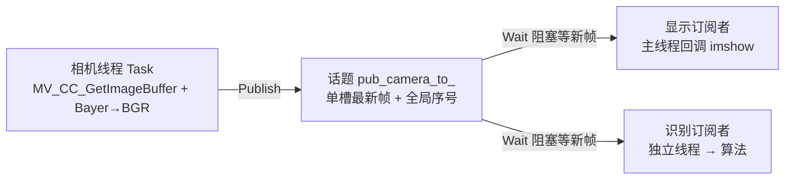

# Dust Vision Architecture

原生 C++17 Linux 进程：海康 USB3 工业相机持续取帧，经**进程内发布订阅话题**交给显示与识别两个消费者各自处理。
采用四层职责 + ELF 注册式启动，**不依赖 ROS 2**。

## 当前做到哪一步

| 部分 | 状态 |
| --- | --- |
| 相机采集 | ✅ 海康 MVS，1440×1080 BayerRG8 → BGR；连续采集、掉线自动重连 |
| 启动容错 | ✅ 设备没插时**先探到设备再初始化**，进程不退出、只在等（避免反复初始化 SDK） |
| 帧出口 | ✅ 进程内话题：单槽最新帧 + 每个订阅者独立游标（慢的丢最旧，不反压采集） |
| 显示 | ✅ 本机窗口，运行期 `var set display.show 0/1` 开关（默认开） |
| 识别 | 🟡 阶段 1 完成：二维类型、灯条长轴规范化、装甲配对评分与冲突消解测试通过；图像灯条提取和运行链尚未接入 |
| 调试台 | ✅ `DUST_LOG` 四色 + DBG 选择；`dust>` 交互 shell（`log` / `var`）；每线程自带 YAML |
| 未做 | 图像灯条提取、数字分类、云台/串口输出、远端可视化；`mujoco/` 目录在，但不参与根 CMake 构建 |

## 数据流



- **取走不清空**：订阅者拿到的是浅拷贝（`cv::Mat` 引用计数共享像素），各自推进自己的游标，互不抢帧；
- **只在有新帧时被唤醒**：空闲 0 唤醒，没有轮询、没有定时器（唯一例外是主线程显示，见下）；
- 相机线程与消费者之间**没有背压**：识别慢了就丢最旧（`Dropped()` 记着），采集永不被拖住。

## 分层

| 层 | 内容 | 依赖 |
| --- | --- | --- |
| `framework/algorithm` | 通用算法（纯头文件） | 仅 Eigen |
| `framework/topic` | 发布订阅通道 + 话题（相机帧） | OpenCV 数据类型 |
| `framework/cmd` | `DUST_LOG`、调试台 shell、调试变量 `var`、YAML 读取 | yaml-cpp |
| `framework/init` | 注册式生命周期、线程封装与恢复 hook、信号 | 无业务依赖 |
| `framework/modules` | 设备模块（海康相机 MVS） | MVS SDK |
| `framework/drivers` | 驱动/通信预留（目录在，尚无实现） | — |
| `project/thread` | 业务线程：`camera` / `display` / `vision` / `test` | 上面各层 |
| `mujoco` | MuJoCo SDK 包装与资源目录 | MVS 之外的仿真用，暂不参与构建 |

依赖单向：`project` → `framework/*`；`framework/algorithm` 不碰 ROS/相机，与具体机器人无关。**每层只拿自己那层的数据**（键盘不认识底盘身高，话题不认识业务）。

## 启动与关闭

业务组件用注册宏声明，链接器把它们收进段表，主线程按阶段遍历启动：

```cpp
REGISTER_INIT(thread_init, EarlyInit, High, HaltOnFail, Release, "camera_init");
REGISTER_THREAD(thread_start, EarlyThread, thread_stop, thread_join, "camera_start");
```

- 顺序：`PreInit/PreThread`（调试台）→ `EarlyInit/EarlyThread`（相机）→ `AppInit/AppThread`（显示、识别、test）；同阶段内 High → Mid → Low；
- 关闭：`System_Shutdown()` **先对所有线程 `request_stop`，再统一 `join`，最后逆序释放资源**——所以"卡在等帧上的订阅者"一定会在相机线程关闭通道后被唤醒；
- 业务 `Task` 里**不写 catch、不写重连**：出错直接抛出，由框架 `Thread::Run` 接住并询问注册的 **RecoveryHook**（`Restart` 重跑 Task / `Stop` 整机退出）。相机线程的 `Recover` 就是"每秒重试 `Reopen()`，直到插回去或收到停止请求"。

## 构建与运行

```bash
dust build       # 增量编译（-p 先清空 build 再全量）
dust run         # 运行 build/project/vision_app
```

入口脚本在 `framework/cmd/build`（`.vscode/settings.json` 已把它加进本工作区终端 PATH）。
每个业务线程的参数在自己的目录里，如 `project/thread/camera/trd_camera.yaml`，构建时复制到可执行文件旁；程序用 `/proc/self/exe` 定位，不依赖工作目录。改成运行目录下那份 YAML 只影响当次运行，改源码目录那份才进版本库。

运行期调试台：

```text
log list | log on camera | log on vision | log off     # DBG 默认静默，要选才出
var list                                              # 看所有可调量（含设备范围）
var set camera_exposure_us 3000                        # 曝光（μs）
var set display.show 0                                 # 关本机窗口（无人值守）
```

`var set camera_*` 走的是"提交给相机线程执行 SDK 写入"，不是 shell 里直接碰设备。

## 改代码前先看这几条

1. **不许 `clone()`**：一帧的路径上 `cv::Mat` 都是浅拷贝共享像素，克隆就把"零成本共享"变成"每订阅者一份内存"；
2. **消费者不带周期超时**（只有主线程显示带 50 ms，那是为了泵 Qt 事件，否则窗口点关闭没反应）；空闲时消费者唤醒数应为 0；
3. **`imshow`/`waitKey` 只能在主线程**：本机 highgui 后端是 Qt5，挪到工作线程会崩；
4. **状态声明在拥有它的线程文件里**，公共头只放类型；不用单例，跨线程用显式指针/注册交出去；
5. **调试变量 `var` 只支持 double**（开关类量写 0/1）；
6. **参数校验只防手滑**：硬件上下限交给设备（换相机/换分辨率才不会失效）；
7. **MVS 运行时进程内只初始化一次**：设备没插时反复 `MV_CC_Initialize`/`MV_CC_Finalize` 会把 SDK 拖崩（实测十几次来回后段错误），所以启动等待先读 sysfs 探测设备、运行时引用不释放。

## 相机接线与帧率（现场经验）

- **必须 USB3 直连**：经 USB2 拓展坞会被链路卡到 **约 24 fps**（37 MB/s 上限 vs 1440×1080 Bayer8 每帧 1.5552 MB）；
- USB3 直连后，1440×1080 的设备上限约 **165 fps**（与曝光无关，是读出/内部吞吐），想更高只能缩 ROI 或 binning；
- **帧周期 ≥ 曝光时间**：曝光 50 ms 时帧率必然降到 20 fps；
- 别为了省转换让相机直出 BGR8：每帧从 1.55 MB 变 4.67 MB，带宽翻三倍、fps 反而掉。

## 文档索引（`doc/`）

| 文档 | 内容 |
| --- | --- |
| [Linux视觉基础骨架建立规划](doc/Linux视觉基础骨架建立规划.md) | 骨架与分层的由来 |
| [相机图像出口与显示解耦规划](doc/相机图像出口与显示解耦规划.md) | 话题/订阅者模型、显示解耦与验收 |
| [HikRobot相机模块与SDK接口说明](doc/HikRobot相机模块与SDK接口说明.md) | 相机模块对外接口与 SDK 节点用法 |
| [HikRobot断线重连机制](doc/HikRobot断线重连机制.md) | 掉线判定与重连流程 |
| [相机运行时线程内调参规划](doc/相机运行时线程内调参规划.md) | `var` 通知版：调参如何回到设备线程 |
| [Var通知版注册与相机调参改造规划](doc/Var通知版注册与相机调参改造规划.md) | 上面那条的改造记录（含类型化说明） |
| [调试台线程CPU空转问题与修改方案](doc/调试台线程CPU空转问题与修改方案.md) | shell 线程从 100 Hz 轮询改成事件驱动 |
| [SIGPIPE问题说明与解决方案](doc/SIGPIPE问题说明与解决方案.md) | 日志断管的处理与验收 |
| [电控架构初始化流程检查报告](doc/电控架构初始化流程检查报告.md) | 启动/关闭流程检查 |
