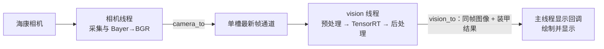

# Dust Vision Architecture

Dust Vision 是一个面向 Linux 的原生 C++17 视觉程序。当前主链从海康 MVS 工业相机取图，经进程内发布订阅通道分别交给 TensorRT 装甲板检测线程和主线程显示。项目使用 CMake 与自有生命周期框架，不依赖 ROS 2。

## 当前能力

| 子系统 | 当前实现 |
| --- | --- |
| 相机 | 海康 MVS SDK；相机线程采集并发布 BGR 图像；支持设备断线恢复流程 |
| 帧通道 | 单槽最新帧、全局序号、每个订阅者独立游标；慢消费者跳过旧帧，不阻塞采集 |
| 装甲板检测 | TensorRT 10 加载 0526 engine；模型输出四点、objectness、颜色和标签分支；OpenCV 完成预处理、NMS 与结果几何校验 |
| 显示 | 主线程使用 OpenCV HighGUI 显示原图与检测结果；可通过 `display.show` 运行时开关 |
| 精修 | `ArmorRefiner` 的局部 OpenCV 灯条提取与角点精修实现已保留，但尚未接入运行主链 |
| 调试 | `DUST_LOG` 日志、交互式 `dust>` shell、`log` 与 `var` 命令、线程 YAML 配置 |

当前识别输出是**单帧检测结果**，尚未实现跨帧跟踪、PnP/距离估计、云台控制或自动开火。独立的全图传统灯条检测器和灯条配对器已从工程移除。`mujoco/` 是独立目录，不参与根 CMake 构建。

## 数据流



- 相机帧通过 `cv::Mat` 浅拷贝共享像素；消费者各自持有订阅游标，互不抢帧。
- 通道只保存最新帧；消费者来不及处理时会丢弃旧帧，避免延迟无限累积和反向阻塞采集。
- 识别线程阻塞等待新帧；显示回调使用有界等待，以便在主线程处理 HighGUI 窗口事件。
- 识别结果携带对应的原始图像与采集时间戳，确保绘制结果与图像来自同一帧。

## 检测流程

```text
相机 BGR 原图
→ 等比例缩放并放入 640×640 黑色画布
→ TensorRT 0526 engine 推理（25200 × 22 输出）
→ objectness 初筛、角点映射回原图、基础几何检查
→ OpenCV NMS 去重
→ 最终置信度、颜色、标签/尺寸及完整几何校验
→ DetectedArmor 结果列表
→ vision_to 发布并由显示侧绘制
```

`DetectedArmor` 保存单个有效装甲的四角点、中心、外接框、颜色、标签、尺寸和 objectness。当前显示的置信度是 objectness，不是颜色或数字分类分数。

`ArmorRefiner` 可选地在已知 YOLO 四点附近提取局部灯条并尝试修正角点；精修失败时保留原始四点。但目前 `project/thread/vision/trd_vision.cpp` 只调用 `ArmorDetector::Detect()`，没有调用精修器，因此运行输出仍是模型后处理产生的四点。

## 代码结构

| 路径 | 职责 |
| --- | --- |
| `framework/init/` | ELF 段注册、启动/关闭阶段、线程生命周期与信号处理 |
| `framework/cmd/` | 日志、交互 shell、运行时变量与 YAML 配置 |
| `framework/topic/` | 相机帧和识别结果的进程内通道 |
| `framework/modules/camera/` | 海康 MVS 相机模块 |
| `framework/algorithm/vision/core/` | 装甲结果、灯条基础类型与几何校验 |
| `framework/algorithm/vision/detect/` | TensorRT 装甲检测与模型类别映射 |
| `framework/algorithm/vision/refine/` | YOLO 粗四点后的可选局部精修 |
| `project/thread/` | 相机、识别、显示和测试业务线程 |
| `mujoco/` | 独立 MuJoCo/ament 包，不由根工程构建 |

## 启动与关闭

`framework/init/main.cpp` 只负责调用统一启动、等待和关闭接口。业务组件通过 `REGISTER_INIT` 与 `REGISTER_THREAD` 放入链接器保留的注册段，启动层按阶段运行：

```text
Pre：shell
→ Early：相机资源初始化与采集线程
→ App：识别、显示与测试组件
```

关闭时框架先请求各线程停止，再等待线程退出，最后逆序释放资源。相机通道关闭会唤醒等待帧的订阅者。线程异常交由框架线程封装和恢复策略处理。

## 构建依赖

根 CMake 当前要求：

- C++17 编译器、CMake 3.16 或更高版本和 pthread；
- Eigen3、OpenCV（`core`、`highgui`、`imgproc`、`dnn`）和 yaml-cpp；
- CUDA Toolkit 12 或更高版本；
- TensorRT 10.x（头文件及 `nvinfer` 库）；
- 完整的海康 MVS SDK，包含 USB3 transport 库；
- TensorRT engine 文件，默认路径为 `build/0526.engine`。

CUDA 和 TensorRT 默认从项目本地 `.venv/` 查找，engine 可通过 CMake 的 `ARMOR_ENGINE_PATH` 指定。配置阶段会检查依赖和 engine；缺少任一项时 CMake 会报错。海康 SDK 根目录可通过 `HIKROBOT_MVS_ROOT` 指定。

## 构建与运行

在项目根目录或其子目录执行：

```bash
dust build       # 增量构建
dust build -p    # 删除 build/ 后全新构建
dust run         # 运行 build/project/vision_app
```

也可以直接使用 CMake：

```bash
cmake -S . -B build -DCMAKE_BUILD_TYPE=Debug
cmake --build build --parallel
./build/project/vision_app
```

`dust` 脚本位于 `framework/cmd/build/`。运行前需要保证 SDK、CUDA/TensorRT 动态库能被系统加载，并连接可用的海康相机；窗口显示需要可用的图形桌面环境。

## 配置与运行时调试

每个业务线程的 YAML 配置放在对应目录，构建时复制到可执行文件旁。运行时按程序所在目录读取配置，因此直接编辑 `build/project/thread/...` 下的副本只影响本次构建目录；要持久修改，请编辑 `project/thread/...` 的源配置并重新构建。

运行后可在 `dust>` shell 使用：

```text
log list                         # 查看可选调试日志
log on vision                    # 打开识别线程调试日志
log off                          # 关闭调试日志
var list                         # 查看运行时变量
var set display.show 0           # 关闭显示窗口
var set camera_exposure_us 3000  # 设置相机曝光时间（微秒）
```

相机参数写入由相机线程执行；shell 不直接调用 MVS SDK。

## 文档

| 文档 | 内容 |
| --- | --- |
| [识别流程说明](doc/framework视觉识别流程说明.md) | 0526 模型输入输出、后处理、数据流和精修边界 |
| [视觉算法分层规划](doc/视觉算法目录分层规划.md) | 视觉算法目录与依赖方向演进记录 |
| [Linux 视觉骨架规划](doc/Linux视觉基础骨架建立规划.md) | 原生 Linux 视觉进程的架构规划 |
| [相机帧出口与显示解耦](doc/相机图像出口与显示解耦规划.md) | 相机帧通道、订阅者和主线程显示设计 |
| [海康相机接口说明](doc/HikRobot相机模块与SDK接口说明.md) | MVS 模块接口与相机采集说明 |
| [海康相机断线重连](doc/HikRobot断线重连机制.md) | 断线检测、恢复与退出行为 |
| [相机运行时调参](doc/相机运行时线程内调参规划.md) | 曝光、增益等参数如何安全提交到相机线程 |
| [初始化流程检查报告](doc/电控架构初始化流程检查报告.md) | 注册启动、失败清理与关闭流程检查 |
| [SIGPIPE 处理说明](doc/SIGPIPE问题说明与解决方案.md) | 日志输出断管时的行为与验证 |
| [调试台 CPU 空转说明](doc/调试台线程CPU空转问题与修改方案.md) | shell 线程事件驱动改造记录 |
