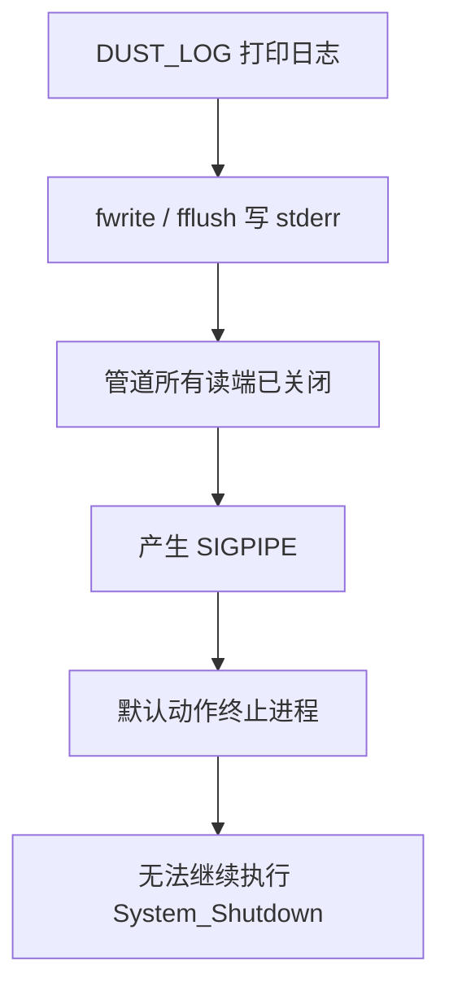
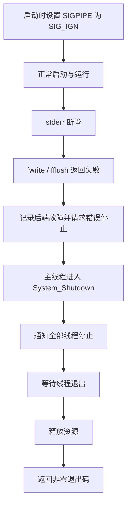

# SIGPIPE 问题说明与解决方案

日期：2026-10-12。

对象：当前 Linux 视觉基础骨架的 stderr 日志输出与统一关闭流程。

本文保留修复前问题与复现记录，并说明已实施的处理方案。2026-10-12 已完成 SIGPIPE 处理、首次发送故障记录，以及终端日志与输入行协调；实施结果见文末第 8、9 节。

## 1. SIGPIPE 是什么

SIGPIPE 是 Linux 的一种信号，常见于**向没有任何读端的管道继续写数据**。管道有写端和读端：程序把数据写进去，另一个程序读出来；如果所有读端都关闭，后续写入就会触发 SIGPIPE。[Linux pipe(7)](https://man7.org/linux/man-pages/man7/pipe.7.html)

SIGPIPE 的默认处理动作是终止进程。它不是普通 C++ 异常，默认终止不会进入 `catch`，也不会按正常退出路径调用项目的 stop、join、cleanup 或 C++ 析构函数。内核会回收进程的文件描述符等系统资源，但不会替项目执行应用层关闭动作。[Linux signal(7)](https://man7.org/linux/man-pages/man7/signal.7.html)

放在本工程中理解：**日志接收端已经退出，视觉程序还在打印日志，操作系统可能直接结束整个视觉进程，导致统一关闭来不及执行。**

信号编号不能跨平台硬编码。本机 SIGPIPE 为 13，代码应始终使用 `SIGPIPE` 符号。[Linux signal(7)](https://man7.org/linux/man-pages/man7/signal.7.html)

## 2. 为什么本工程会遇到它

### 2.1 stderr 可以被接到管道

stderr 是标准错误输出，文件描述符为 2。当前 `DUST_LOG` 的输出后端使用 stderr。直接在终端运行时，它通常连接终端；经重定向后，也可以连接文件、管道或其他接收端。

例如：

```bash
dust run 2>&1 | head -n 1
```

这里把 stderr 合并到 stdout，再交给 `head`。`head` 读取一行后退出；如果所有读端随之关闭，程序之后继续写日志，就可能触发 SIGPIPE。这个示例受执行时序影响，适合解释，不适合作为唯一的验收用例。

仅执行 `dust run | head -n 1` 时，普通管道连接的是 stdout，当前 stderr 日志仍留在原来的输出端，不能据此认定已经测试了日志断管。

### 2.2 修复前源码处理到了哪里

| 文件 | 当前职责 | 与本问题的关系 |
| --- | --- | --- |
| [signal_handler.cpp](../framework/init/signal_handler.cpp) | 安装 SIGINT、SIGTERM 处理 | 没有明确安装 SIGPIPE 策略 |
| [log_transport.hpp](../framework/cmd/shell/log_transport.hpp) | 用 `fwrite`、`fflush` 写 stderr | 底层写入断管可能触发 SIGPIPE |
| [log.cpp](../framework/cmd/shell/log.cpp) | 检查发送结果 | Send 返回 false 后会调用 `System_RequestStop(1)` |
| [Init_entry.cpp](../framework/init/Init_entry.cpp) | 保存停止状态、等待、关闭 | 只有进程仍能执行用户代码时，才有机会走关闭流程 |
| [main.cpp](../framework/init/main.cpp) | 调用统一生命周期 | 正常返回路径最终执行 `System_Shutdown()` |

修复前发送代码为：

```cpp
return std::fwrite(frame.data.data(), 1, size, stderr) == size &&
       std::fflush(stderr) == 0;
```

底层写入可能发生在 `fwrite` 内，也可能发生在刷新缓冲区的 `fflush` 内。`fflush` 写失败会返回 EOF 并设置 errno，但默认 SIGPIPE 可能先终止进程，后面的返回值检查就失去作用。[Linux fflush(3)](https://man7.org/linux/man-pages/man3/fflush.3.html)

### 2.3 修复前故障路径



问题发生在“能否返回到正常代码处理错误”这一层。继续给 `Send()` 外面加 `try/catch`，不能替代 SIGPIPE 策略。

### 2.4 修复前实测

修复前对当时的 `build/project/vision_app` 做了两个独立进程测试，没有修改源码或线程 YAML：

| 输出目标 | 本次结果 | 含义 |
| --- | --- | --- |
| 管道，启动前关闭其唯一读端 | Python returncode 为 `-13` | 被 SIGPIPE 终止 |
| `/dev/full` | returncode 为 `1` | 发送失败能够进入现有错误退出路径 |

Python 的负返回码表示被对应编号的信号终止，`-13` 不是项目主动返回了负数。不能把 Python 的 returncode 与 shell 管道命令的 `$?` 混为一谈；验收应直接检查目标进程的退出状态。[Python subprocess 文档](https://docs.python.org/3/library/subprocess.html#subprocess.CompletedProcess.returncode)

`/dev/full` 是写入失败的对照，它不是断管，因此不能替代 SIGPIPE 测试。该对照的退出码也不能单独证明每个清理回调都已执行。

## 3. 采用什么处理策略

本基础骨架采用：**在平台启动时忽略 SIGPIPE，让日志发送失败返回到普通代码，再沿现有 `System_RequestStop(1)` 路径关闭进程。**

忽略信号并不会修复管道，也不意味着忽略发送错误。在没有读端的管道上，忽略 SIGPIPE 后，底层 `write` 仍会失败，并以 EPIPE 表示断管。[Linux pipe(7)](https://man7.org/linux/man-pages/man7/pipe.7.html)

因此这是两步处理：

1. 平台层阻止 SIGPIPE 的默认终止动作。
2. 日志层识别发送失败并请求错误关闭。

保持当前日志发送失败即退出的策略。后续若明确要求日志故障时业务继续运行，应另外制定故障记录与降级契约；本次不顺带改变该行为。

## 4. 具体修改方案（已实施）

### 4.1 在平台准备阶段安装 SIGPIPE 策略

在 `framework/init/signal_handler.cpp` 的 `InstallSignalHandlers()` 中，先设置 SIGPIPE 为 `SIG_IGN`，再安装现有 SIGINT、SIGTERM 处理。该函数现在由 `System_Startup()` 在遍历注册表、输出启动日志、创建 shell/test 线程之前调用，位置符合需求。

已添加的核心代码如下：

```cpp
struct sigaction pipe_action{};
pipe_action.sa_handler = SIG_IGN;
sigemptyset(&pipe_action.sa_mask);

if (sigaction(SIGPIPE, &pipe_action, nullptr) != 0)
{
    throw std::runtime_error("cannot ignore SIGPIPE");
}
```

`sigaction` 的 `SIG_IGN` 表示忽略该信号。[Linux sigaction(2)](https://man7.org/linux/man-pages/man2/sigaction.2.html)

该信号处理策略作用于整个进程，因此 shell 与 test 等线程都受保护；线程各自屏蔽信号是另一种机制，不能混为一谈。[Linux signal(7)](https://man7.org/linux/man-pages/man7/signal.7.html)

不要在工作线程创建以后才安装，也不要放到 test 业务初始化里。启动期就会输出日志，平台策略必须先准备好。现阶段不增加新的 REGISTER_INIT 等级或修改阶段顺序。

如果安装信号策略本身失败，先请求错误停止并退出启动，不向策略尚未建立的 stderr 打印错误。`System_Startup()` 已将平台信号准备与注册表启动分开捕获；后者在请求停止后再输出错误。

### 4.2 保留写入与刷新检查

保留 `LogTransport::Send()` 对实际写入字节数和刷新结果的检查。只安装 `SIG_IGN` 而不处理返回值，会让程序带着已失效的日志输出继续运行。

发送实现已移到现有后端的 [log_transport.cpp](../framework/cmd/shell/log_transport.cpp)。`Write()` 检查 `fwrite` 是否完整写入，完整写入后检查 `fflush`；任一失败立即保存 errno 并返回 false。errno 未提供有效原因时记为 EIO。

首次故障保存在 `LogTransport` 内，由现有日志互斥锁保护，`LastError()` 可读取原因。发送端失效后不再重复写入，后续日志经既有路径报告停止；`Log::Init()` 重置发送故障状态。没有新增全局配置或业务对象。

断管是永久失效路径，不在当前关闭流程中做无限重试，也不因 `clearerr(stderr)` 清除了流错误标志就认为管道恢复。

### 4.3 从普通代码请求统一关闭

当前 `Log::Drain()` 已有：

```cpp
if (!pump_.Send(frame))
{
    System_RequestStop(1);
}
```

保留这条链路。`System_RequestStop()` 保存错误状态、提交停止请求；主线程随后进入 `System_Shutdown()`，先通知全部线程停止，再等待退出，最后释放资源。

**不要在这里调用 `DUST_LOG_ERR` 报告“日志发送失败”。** 当前 Drain 由持有日志 mutex 的代码调用，再进入同一日志接口可能造成递归加锁，并且目标 stderr 本身已经失效。

同样，不要从发送工作线程直接执行 `System_Shutdown()`；关闭由主线程执行，避免线程等待自身和生命周期并发操作。

### 4.4 主线程关闭不依赖日志写成功

修复后预期路径：



stderr 已经断开，关闭过程中没有 joined/released 日志是可能的。清理回调必须继续执行，不能把“成功打印清理日志”作为清理动作的前置条件。

此修复仅恢复断管时进入统一关闭的机会。真实设备的停止、禁能和可取消 I/O 仍由设备所属组件实现；本工程当前没有这些设备，不能宣称硬件安全停机已经验证。

## 5. 不采用哪些替代做法

| 做法 | 为什么不能作为本问题的完整修复 |
| --- | --- |
| 只在日志外面加 try/catch | 默认 SIGPIPE 终止不属于普通 C++ 异常 |
| 只忽略 SIGPIPE，忽略返回值 | 管道仍然失效，发送错误没有进入生命周期处理 |
| 在信号回调里调用日志、join 或 cleanup | 信号上下文不适合锁、线程等待和复杂资源操作；当前故障还可能发生在日志锁内 |
| 直接 exit/abort | 绕过现有 stop/join/cleanup 组织方式 |
| 修改 dust run，让 shell 临时吞掉信号 | 平台能力应由应用建立，直接运行可执行文件也必须一致 |

信号回调中的函数调用必须满足异步信号安全要求；stdio 等接口不能当作普通上下文一样调用。[Linux signal-safety(7)](https://man7.org/linux/man-pages/man7/signal-safety.7.html)

## 6. 验收方法

### 6.1 可重复的断管复现

构建后，在工程根目录执行下面的独立测试。它明确关闭所有读端，不依赖 `head` 的执行时序：

```bash
python3 - <<'PY'
import os
import subprocess

read_fd, write_fd = os.pipe()
os.close(read_fd)

try:
    process = subprocess.Popen(
        ["./build/project/vision_app"],
        stdin=subprocess.DEVNULL,
        stdout=subprocess.DEVNULL,
        stderr=write_fd,
        restore_signals=True,
    )
finally:
    os.close(write_fd)

try:
    print("returncode =", process.wait(timeout=3))
except subprocess.TimeoutExpired:
    process.kill()
    process.wait()
    raise SystemExit("FAIL: 超时，不能判定正常关闭")
PY
```

`restore_signals=True` 会在启动子程序前恢复 Python 忽略的相关信号，其中包括 SIGPIPE，避免把 Python 自身的信号状态当成应用修复。[Python Popen 文档](https://docs.python.org/3/library/subprocess.html#subprocess.Popen)

修复前本次结果为 `-13`；修复后按当前策略应为 `1`。超时后强杀属于失败，不能当作关闭通过。

该用例验证启动期断管。运行期测试应先保留读端、排空并确认线程启动，再关闭所有读端，并触发后续日志写入；只关闭读端但没有继续写入，无法覆盖 SIGPIPE 路径。可使用独立线程测试程序主动发送日志，不必修改正式线程 YAML。

### 6.2 清理必须有独立证据

退出码为 1 只能说明错误退出，不能单独证明 stop/join/cleanup 全部完成。

正式测试应在独立测试目标中注册真实工作线程，让 stop、join、cleanup 写入测试计数或独立临时文件；stderr 使用断管。关闭后经 stdout 或该临时文件核对：所有停止通知发生在等待之前，线程已经退出，资源最后释放，清理仅执行一次。

启动前断管可能让 test 线程尚未创建，因此不能要求该用例证明 test 已经 join；应分别验证启动失败回滚和已运行线程关闭。

### 6.3 验收矩阵

| 场景 | 修复后的预期 | 必要证据 |
| --- | --- | --- |
| 普通终端输出 | 日志与交互正常 | SIGINT/SIGTERM 仍正常退出 |
| stderr 重定向普通文件 | 正常运行 | 日志内容写入、关闭成功 |
| 启动前 stderr 已断管 | 错误退出 1，无 SIGPIPE 终止 | 已初始化部分的清理标记 |
| 运行中 stderr 断管且再次写日志 | 错误退出 1 | 已运行线程的 stop/join 与资源释放标记 |
| stderr 指向 `/dev/full` | 错误退出 1 | 原发送失败行为保持 |
| 同一失效后端被多次调用 | 不递归、不无限重试 | 有限时间退出，首次故障状态保留 |
| Debug 与 Release | 构建及相关测试通过 | 原 3 项测试和新增断管、终端输入测试均通过 |

## 7. 修改范围与剩余边界

实施范围限定在平台信号策略、现有日志发送失败路径、必要的启动失败处理和相关测试说明。保留 main、framework/project 分层、REGISTER_INIT/REGISTER_THREAD、阶段配对与 High → Mid → Low。

该方案不解决“读端仍打开但一直不读取”的情况：管道写满后，同步写入可能阻塞；忽略 SIGPIPE 不会让阻塞 I/O 自动获得超时。[Linux pipe(7)](https://man7.org/linux/man-pages/man7/pipe.7.html)

这项慢输出问题应单独设计有界发送和关闭时限，不能混入本次断管修复的验收结论。

## 8. 日志打断命令输入的处理

原终端由内核直接回显按键，后台日志同时输出到同一屏幕。例如输入 `log off` 时，可能显示成 `lapplication heartbeat`、`ogapplication heartbeat`、`off`。这是输出与输入显示混排，日志并没有作为命令字节写入 stdin。

已采用同一把日志输出锁协调显示：

1. stdin、stderr 都连接同一个终端且 `TERM` 不是 dumb 时，保存终端属性，关闭 ICANON、ECHO，保留 ISIG，shell 逐字接收并回显命令。
2. 显示 `dust> ` 提示符，将输入副本及光标位置保存在后端，实际待解析的命令仍由 Shell 持有。
3. 打印日志前用回车及 ANSI 清行删除当前输入显示，打印完整日志后恢复提示符、输入内容和光标。
4. 回车提交完整命令；支持退格、左右、Home/End、Delete 与 Ctrl+U。当前编辑器面向 ASCII 调试命令，最长 255 字节，长命令按终端宽度横向滚动，超长整行丢弃。
5. 正常退出、信号退出或启动失败清理都恢复原终端属性。发送故障也不跳过属性恢复。

对应实现位于 Shell、Log 和现有 LogTransport 中。输入快照与日志发送串行，不引入另一套线程或日志接口。终端输入控制依据 [Linux termios 手册](https://man7.org/linux/man-pages/man3/termios.3.html)。

stdin/stderr 被重定向、位于不同终端，或 `TERM=dumb` 时，不接管输入回显，不输出提示符及输入重绘控制序列。该路径仍处理普通整行命令，并保留纯文本重定向输出。

## 9. 修复后的正式验证

修复时根 CMake 新增两个正式测试。当前工程已无 `tests` 目录，对应测试目标已移除；以下为当时的验证记录：

| 测试 | 验证内容 | 结果 |
| --- | --- | --- |
| `broken_pipe_cleanup` | 真实线程运行后关闭日志读端；首次错误为 EPIPE；后端失效后不重复发送；统一退出状态为 1；事件为 ITSJR；重复关闭不重复清理 | 通过 |
| `terminal_input` | 每个输入字符之间持续输出心跳，日志后恢复完整命令；编辑 `log off` 并成功执行；长命令横向滚动；CRLF 只提交一次；Ctrl+C/SIGTERM 后恢复原 termios；管道输入输出无提示符和 ANSI；启动前断管退出 1 | 通过 |

`terminal_input` 使用伪终端和独立临时部署，心跳间隔设为 20 ms，不修改正式线程 YAML。Ctrl+C 用实际终端按键产生 SIGINT。运行期断管的资源释放由测试内事件序列和线程退出状态核对，不依赖失效的 stderr 日志。

Debug 与 Release 构建各 5/5 项测试通过，原 3 项测试保持通过；另检查 stderr 指向 `/dev/full` 仍退出 1。没有用超时强杀作为通过证据。

验证覆盖当前心跳、终端和日志生命周期，不表示慢输出已获得时间上界，也不表示真实相机或设备安全停机已经验证。
