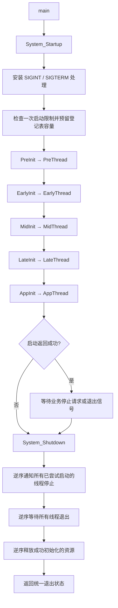

# 电控架构初始化流程检查报告

检查日期：2026-10-12。检查对象：当前 `opencv` 工作区的 Linux C++17 活动架构。

后续修复记录（2026-10-12）：第 5.5 节的 SIGPIPE 断管问题已修复并加入正式测试；另已修复后台日志打断终端输入显示的问题。具体实现与验证见 [SIGPIPE 问题说明与解决方案](SIGPIPE问题说明与解决方案.md)。以下原始检查过程和结果保留为修复前记录，其余建议不因这两项修复自动视为完成。

构建整理记录：当前工程已无 `tests` 目录，根 CMake 中对应的测试目标已移除。下文测试结果与命令属于检查时记录。

## 1. 总体结论

**当前初始化流程作为 Linux 基础线程骨架已经形成闭环，但还不能判定为完善的实际电控启动架构。**

已经实现并验证的主链路是：统一入口、ELF 注册、分阶段初始化、初始化等级排序、线程创建、配置失败中止、停止通知、线程等待、逆序资源释放和退出码返回。当前 shell 与 test 心跳线程的正常启动、错误配置回滚、信号退出均通过本次检查。

主要缺口集中在以下几个方面：

1. 初始化项与线程项没有依赖关联，`ContinueOnFail` 后仍可启动依赖失败资源的线程。
2. 创建线程与业务就绪没有区分，缺少就绪确认和运行许可。
3. 初始化、设备阻塞操作、线程等待和日志输出没有统一的时间上界。
4. 初始化失败项会立即清理，此时早期阶段线程可能仍在运行，需要明确资源访问约束。
5. stderr 断管会触发 SIGPIPE，绕过统一关闭流程；本次已复现。
6. 启动和清理的故障日志不够完整，现有测试对真实线程和异常路径的覆盖有限。

本次交付为检查文档，没有修改业务源码、注册接口和线程 YAML。验证用例在临时目录运行，错误配置没有写入项目原始配置。

## 2. 检查范围与能力边界

检查了根 CMake、framework/project 装配、`framework/init` 全部文件、配置读取类、shell 与日志生命周期、test 线程及其 YAML，以及现有 3 项测试。

当前根构建只纳入 `framework` 和 `project`。`mujoco` 没有加入根构建；`temp/Dust_Zephyr_Tree` 与 `temp/baseline_linux_skeleton` 是参考或归档，不作为当前运行程序的实现依据。

本次实际检查时，`framework/drivers`、`framework/modules`、`framework/topic` 下没有实现文件。活动业务仅有 shell 和 test 心跳线程，没有相机、CAN、串口、电机、IMU、控制器装配或执行器使能链路。因此：

- 可以确认当前 Linux 线程骨架的启动和退出行为。
- 不能确认设备就绪、电机安全使能、控制闭环或目标板实时性。
- `framework/algorithm` 中存在计算代码，不代表这些算法已经注册、初始化或进入控制循环。

依据：[根 CMake](../CMakeLists.txt) 第 7～11 行、[framework 装配](../framework/CMakeLists.txt) 第 3～14 行、[project 装配](../project/CMakeLists.txt) 第 1～11 行。

## 3. 当前真实启动链路

### 3.1 总入口和阶段顺序



每个 Init 阶段内部按 **High → Mid → Low** 执行。同等级多项按链接表顺序执行；Thread 阶段按链接表顺序执行，没有独立等级。

注意：当前是“一个阶段初始化完就启动该阶段线程”，随后继续初始化下一阶段，**并非全部资源初始化完才启动所有线程**。早期线程与后续初始化可能并行。

依据：[main.cpp](../framework/init/main.cpp) 第 18～24 行、[Init_entry.cpp](../framework/init/Init_entry.cpp) 第 90～210 行。

### 3.2 当前程序实际注册项

| 顺序 | 注册名称 | 阶段/等级 | 实际动作 | 失败策略 |
| --- | --- | --- | --- | --- |
| 1 | `shell_init` | PreInit / High | 清空日志 DBG 注册状态和队列，恢复启动期直发模式 | HaltOnFail |
| 2 | `shell_start` | PreThread | 创建 shell 线程；Task 接管日志发送并轮询 stdin | 启动失败统一中止 |
| 3 | `test_init` | AppInit / High | 定位并读取线程 YAML，检查字段和整数范围，登记 test DBG | HaltOnFail |
| 4 | `test_start` | AppThread | 创建 test 线程，运行可中断心跳循环 | 启动失败统一中止 |

Early、Mid、Late 当前没有活动注册项。shell Task 与 test 配置读取可并发运行，日志访问使用公共互斥锁。

依据：[shell.cpp](../framework/cmd/shell/shell.cpp) 第 75～151、159～201 行、[trd_test.cpp](../project/thread/test/trd_test.cpp) 第 36～46、93～117 行。

### 3.3 配置进入线程的路径

```text
project/thread/test/trd_test.yaml
    → configure_file(COPYONLY)
build/project/thread/test/trd_test.yaml
    → /proc/self/exe 定位 vision_app 所在目录
    → Config::Load 校验 YAML 根节点和字段集合
    → Config::GetInt 校验类型、范围
    → params_
    → thread_start / Task
```

`heartbeat_ms` 范围为 1～60000 ms；`run_duration_ms` 范围为 0～86400000 ms，0 表示等待停止请求。配置在创建 test 线程前完成，Task 不重新解析 YAML。

配置归属合理：各线程声明自己的字段和范围，cmd 层只提供通用读取工具，没有全局业务配置对象。

依据：[config.cpp](../framework/cmd/config/config.cpp) 第 31～129 行、[线程统一装配 CMake](../project/thread/CMakeLists.txt) 第 3～9 行、[trd_test.cpp](../project/thread/test/trd_test.cpp) 第 24～46 行。

### 3.4 失败和退出的清理顺序

初始化回调返回 false 或抛异常时，会立即调用本项 cleanup。HaltOnFail 随后提交错误停止请求并中止启动；ContinueOnFail 则允许继续遍历。

成功初始化的资源才加入 `resources`。线程注册项在调用 start **之前**加入 `threads`，因此 start 创建线程后又失败的情况仍能进入 stop/join。

正常停止时，先通知 test 与 shell 停止，再等待 test 与 shell，最后释放 test 与 shell 资源。shell 退出会 Flush 并恢复直发模式，之后的资源清理日志仍能输出。

配置失败时，test 的 Release 会先执行；test_start 不执行，已启动的 shell 再由统一关闭流程停止和等待。

依据：[Init_entry.cpp](../framework/init/Init_entry.cpp) 第 121～133、160～175、245～265 行、[shell.cpp](../framework/cmd/shell/shell.cpp) 第 151、186～197 行。

## 4. 已经完善的部分

| 检查项 | 判断 | 依据或实测 |
| --- | --- | --- |
| 唯一 main 与业务解耦 | 已具备 | main 仅调用 Startup、Wait、Shutdown |
| 阶段与等级排序 | 已具备 | 五组阶段配对；High/Mid/Low 测试通过 |
| 注册项链接保留 | 当前目标已验证 | 指针段、KEEP、注册源直接加入 executable；Debug/Release 段完整 |
| 初始化异常处理 | 已具备 | 回调异常转为初始化失败，并执行本项清理 |
| 关键配置失败中止 | 已验证 | 当前 test 使用 HaltOnFail，错误配置均未启动 test 线程 |
| 部分线程启动失败回收 | 已验证基础路径 | 隔离用例创建真实线程后返回 false 或抛异常，stop/join/release 顺序正确 |
| 运行任务异常处理 | 已验证基础路径 | 公共 Thread::Run 捕获异常并请求错误停止 |
| 通知全部线程后再等待 | 已具备 | 避免等待一个线程时其他线程尚未收到停止通知 |
| 资源逆序释放 | 已具备 | 按实际初始化顺序登记，逆序 cleanup |
| 重复关闭 | 已验证 | 现有测试第二次 Shutdown 不重复执行清理回调 |
| 配置字段与取值检查 | 已验证当前字段 | 缺失、未知、重复、类型错误、越界均拒绝 |
| 运行目录独立性 | 已验证 | 复制程序及配套 YAML 后，从 `/tmp` 启动成功 |
| 可中断心跳等待 | 已验证 | heartbeat=60000 ms 时，信号停止无需等待完整心跳周期 |
| 错误退出码保留 | 已具备 | 正常停止不覆盖非零状态；清理异常置错误状态 |

这些结果表明骨架不是只有接口声明，其主要生命周期已经落实。各项验证的具体范围见第 6 节。

## 5. 缺口与改进建议

优先级含义：P1 为接入真实设备前应解决或明确保证的事项；P2 为基础框架稳健性与可观测性；P3 为文档和交付一致性。没有发现当前心跳链路的 P0 级问题。

### 5.1 P1：失败策略没有约束依赖线程

**性质：已复现的接口行为；当前项目尚未触发，因为两个初始化项都使用 HaltOnFail。**

InitEntry 与 ThreadEntry 只有阶段，没有所属组件或依赖关联。某个 AppInit 返回 false，若策略为 ContinueOnFail，清理本项后仍会执行 AppThread 的所有启动项。

隔离用例结果：

```text
初始化失败 → 失败项释放 → 线程启动 → 停止 → 等待
startup=true status=0 events=IRTSJ
```

这符合“继续执行”的现有定义，但不等于“组件可以安全使用”。允许可选功能降级时，退出码为 0 也可以合理；问题是系统目前没有表达降级状态或阻止依赖者启动的机制。

建议：关键设备和控制链继续使用 HaltOnFail。可选组件使用 ContinueOnFail 时，至少由组件保存初始化状态，由对应 start 检查；再扩展时可在注册元数据中增加组件关联或必需依赖，使失败组件的依赖者被明确跳过。无需为了表达依赖增加同等级数字优先级。

依据：[Init_entry.hpp](../framework/init/Init_entry.hpp) 第 74～94 行、[Init_entry.cpp](../framework/init/Init_entry.cpp) 第 127～136、148～175 行。

### 5.2 P1：线程创建成功不能证明业务就绪

**性质：当前能力边界；心跳任务没有设备就绪要求，真实设备链路待验证。**

Thread::Start 创建 std::thread 后返回；线程名设置和 Task 执行在工作线程中进行。主线程可以继续启动后续组件，无法确认前一个 Task 已完成通信连接、首帧接收或设备自检。

运行异常能触发停止，但这发生在业务开始之后；它不能替代运行前的就绪检查。当前 shell 有 `MarkShellThreadReady()` 用于日志发送归属，该标志没有形成通用启动屏障。

建议区分三个状态：资源初始化完成、工作线程就绪、允许输出控制命令。对有依赖的线程增加带超时的就绪确认，禁止在等待就绪时无限阻塞。必要时先启动采集与通信线程，验证数据有效后再开放控制输出。

依据：[thread.hpp](../framework/init/thread.hpp) 第 61～80、127～145 行、[shell.cpp](../framework/cmd/shell/shell.cpp) 第 75～77 行。

### 5.3 P1：停止与初始化缺少时间上界

**性质：源码确认的能力边界；当前可中断等待通过验证，设备阻塞尚无实现可测。**

RunStage 同步调用初始化和线程启动回调，不能在回调内部阻塞时继续检查 stop。Thread::Join 直接等待，没有超时；RequestStop 只能唤醒本对象 condition_variable，不能自动取消设备 read、第三方 SDK 调用或其他互斥锁等待。

因此“收到了停止标志”不能保证“能够退出”，当前 SIGINT/SIGTERM 的快速退出结果仅覆盖 shell 和心跳。

建议把有限等待写进组件契约：初始化超时、读写超时、停止解除阻塞和关闭时限。驱动提供可取消 I/O 或有限超时轮询；主线程在运行阶段及时广播停止。若线程超过关闭时限仍未退出，先进入执行器安全状态并报告故障；不能直接释放其仍在访问的对象，也不能用 detach 假装回收完成。

依据：[Init_entry.cpp](../framework/init/Init_entry.cpp) 第 110、165、234～255 行、[thread.hpp](../framework/init/thread.hpp) 第 86～119 行。

### 5.4 P1：失败项立即清理的资源边界需要约束

**性质：扩展时的条件性风险；当前 test Release 只打印日志，没有复现悬空访问。**

阶段设计允许 PreThread 在 EarlyInit/AppInit 执行前运行。后续初始化失败时，本项 cleanup 会先执行，统一 stop/join 随后才发生。如果失败项已经把部分资源交给早期线程使用，提前释放就可能与线程访问冲突。

建议初始化成功前不发布资源，失败 cleanup 只处理尚未被其他线程使用的私有资源。成功后才对外发布并开放使用。需要跨线程共享的资源，应明确停止消费者、等待退出、再释放的顺序；不能仅以“逆序清理”替代访问关系检查。

依据：[Init_entry.cpp](../framework/init/Init_entry.cpp) 第 127、194～210、249～261 行。

### 5.5 P1：stderr 断管会绕过统一关闭

**性质：当前程序已复现的问题。**

LogTransport 通过 fwrite/fflush 向 stderr 写入，只检查返回值。平台启动仅安装 SIGINT/SIGTERM 处理，没有处理 SIGPIPE。

本次将 stderr 接到已关闭读端的管道，程序退出值为 `-13`，表示被 SIGPIPE 终止。该路径不会走 main 中的 System_Shutdown；因此依赖关闭回调发送安全命令的未来电控组件会失去这条清理路径。

建议在创建线程前明确 SIGPIPE 策略，例如忽略信号并通过写失败转为统一错误停止。日志后端仍应处理写失败并记录自身故障状态。不要将“日志发送失败能 RequestStop”理解为已经覆盖断管信号。

对照用例：stderr 指向 `/dev/full` 时，程序返回 1，说明返回值形式的写失败路径能够报告错误。

依据：[signal_handler.cpp](../framework/init/signal_handler.cpp) 第 34～48 行、[log_transport.hpp](../framework/cmd/shell/log_transport.hpp) 第 31～34 行、[log.cpp](../framework/cmd/shell/log.cpp) 第 212～220 行。

### 5.6 P1：同步日志会影响启动、控制和退出时限

**性质：源码确认的条件性风险；本次未进行长期慢输出压力试验。**

日志在持有公共 mutex 时执行同步 fwrite/fflush。启动早期直接 Drain，shell 运行后事件队列满也会由调用方同步 Drain。慢终端或不读取的管道可阻塞输出，其他日志调用者也会等待同一把锁；Flush 在关闭时同样依赖发送完成。

因此当前队列有界，并不表示日志调用耗时有界。不能直接将这套输出方式用于要求固定周期的控制线程。

建议控制循环只做有界入队，发送由专用后端负责并使用明确的超时、丢弃或故障策略。关闭时也要限定日志排空时间。启动失败和执行器安全停机不能依赖日志首先写出成功。

依据：[log.cpp](../framework/cmd/shell/log.cpp) 第 122～125、188～220、238～242 行、[log_transport.hpp](../framework/cmd/shell/log_transport.hpp) 第 31～34 行。

### 5.7 P2：启动返回值没有覆盖最后回调的停止请求

**性质：已复现的状态语义边界；当前 main 仍能正确进入关闭，不丢失错误退出码。**

RunStage 只在回调之前检查 stop 和信号。最后一个启动回调若调用 System_RequestStop 后返回 true，后面没有注册项再检查停止状态，System_Startup 仍可能返回 true。

隔离用例：最后 start 调用 `System_RequestStop(7)` 后返回 true，得到 `startup=true status=7`。main 的 Wait 会立即结束，Shutdown 保留 7；但调用者若把 true 解释为“当前可运行”，则判断不准确。

建议在回调完成后和启动流程末尾复查停止状态，或明确返回值仅表示“回调返回成功”，再提供运行状态。现有一次启动约束是合理范围，不必为了这一问题增加同进程重启。

依据：[Init_entry.cpp](../framework/init/Init_entry.cpp) 第 101～124、155～178、210～221 行。

### 5.8 P2：任务正常返回没有运行状态上报

**性质：已复现的接口行为；当前 test 有限运行已显式调用 System_RequestStop，不受影响。**

Thread::Run 在 Task 抛异常时请求停止，但 Task 正常返回后没有状态上报。隔离用例中工作任务已经返回，主线程在 100 ms 后仍等待停止，发送 SIGTERM 后才结束。

有限任务正常结束未必需要停止整个进程，但必要的常驻控制线程意外返回不能被当作正常运行。

建议由线程声明有限任务或必要常驻任务，记录 Running/Exited/Failed 状态。常驻任务在未收到停止请求时返回，应报告故障；有限任务则按业务契约处理。不要把所有正常返回统一改为全局停止。

依据：[thread.hpp](../framework/init/thread.hpp) 第 127～145 行、[trd_test.cpp](../project/thread/test/trd_test.cpp) 第 74～77 行。

### 5.9 P2：错误诊断和注册检查不足

**性质：源码确认，其中线程启动失败日志已由隔离用例复现。**

线程启动回调调用前就打印 `[ok] ... start`，即使随后返回 false 或抛异常，也没有包含线程名称和异常原因的失败日志。清理回调异常被捕获并置错误状态，但没有说明哪个 stop/join/cleanup 失败。

注册表也没有启动前的完整校验：必需回调、阶段值、等级值、名称，以及拥有实际线程的项目是否提供 stop/join。当前宏和注册项合法，现有测试中 nullptr 清理回调用于无资源假线程，不能一概禁止。

建议把“尝试启动”和“创建成功”日志分开，记录回调类型、组件名称、异常原因和耗时。启动前验证注册元数据；允许无资源项省略 cleanup，但拥有工作线程的业务项必须保证 stop/join 契约。早期其他模块若也使用 PreInit/High，不应依赖链接顺序保证 Log::Init 最先执行。

此外，System_startup.hpp 的 `@throws` 仍提及“注册项排序冲突”，当前实现没有这项检查；重复启动和资源分配等标准异常会被 System_Startup 转为 false，应同步更新接口说明。

依据：[Init_entry.cpp](../framework/init/Init_entry.cpp) 第 52～66、97～106、160～175、216～228 行、[System_startup.hpp](../framework/init/System_startup.hpp) 第 14～17 行。

### 5.10 P2/P3：测试与部署说明还需补齐

现有 startup_failure 和 startup_levels 测试通过，但其 Worker 回调没有创建真实线程，主要验证事件顺序。本次真实线程异常用例是在临时目录执行，还未纳入仓库测试。

建议优先固化：真实线程部分启动失败、Task 异常、清理异常后继续清理、ContinueOnFail 的依赖约束、启动期间停止、断管日志，以及实际设备取消阻塞和关闭时限。

YAML 构建复制和运行定位通过验证，但当前没有完整 install 规则。部署需要保证可执行文件、`thread/test/trd_test.yaml` 和依赖库一起交付；后续新增线程不能遗漏其配置。日志校验错误通常只显示配置文件名，多线程配置增多后可补充完整解析路径。

当前 README 第 26 行和原规划第 280 行仍称图像/结果契约已实现，但本次 `framework/topic` 目录没有文件，应以当前源码为准，将说明改为预留或待实现。本次只记录差异，没有修改原文档。

依据：检查时的 `tests/startup_failure.cpp` 第 31～44、63～77 行、`tests/startup_levels.cpp` 第 44～47、65～69 行（这些测试源现已不在工程中），以及当时的 README 与 [原规划](Linux视觉基础骨架建立规划.md)。

## 6. 本次验证记录

### 6.1 构建、既有测试和 ELF 注册段

本次重新配置并构建活动 Debug 目录；Release 使用独立临时构建目录，未改变活动 Debug 的构建类型。

```bash
cmake -S . -B build -DCMAKE_BUILD_TYPE=Debug
cmake --build build -j 4
ctest --test-dir build --output-on-failure

cmake -S . -B /tmp/opencv-init-audit-gfq5hxx3/release -DCMAKE_BUILD_TYPE=Release
cmake --build /tmp/opencv-init-audit-gfq5hxx3/release -j 4
ctest --test-dir /tmp/opencv-init-audit-gfq5hxx3/release --output-on-failure

readelf -SW build/project/vision_app
nm -n build/project/vision_app
```

结果：Debug、Release 均构建成功，两个构建各 3/3 项 CTest 通过：`startup_failure_cleanup`、`startup_level_order`、`log_semantics`。

两个构建的 `.user_init` 与 `.user_thread` 均为 `0x10` 字节。当前主机每个指针 8 字节，对应各 2 项注册；Debug 的 nm 也确认 shell/test 指针和四个段边界符号存在。此结果验证当前目标的注册保留，不能替代未来把注册源移入静态库或更换工具链后的检查。

### 6.2 当前应用实测

应用复制到临时部署目录，保留程序旁 YAML 目录结构，工作目录使用 `/tmp`，stdin 使用 EOF。每项测试有 3 秒外部保护时限，以下用例均自行结束，没有靠超时杀进程得到“通过”。

| 场景 | 本次结果 | 能证明的范围 |
| --- | --- | --- |
| heartbeat=10 ms，duration=60 ms | 退出 0，约 72.8 ms；有 joined/released 日志 | 有限运行进入正常关闭 |
| 配置文件不存在 | 退出 1；test_start 未执行 | 路径缺失触发失败回滚 |
| 缺少必需字段 | 退出 1；test_start 未执行 | 必需字段检查 |
| 未知字段 | 退出 1；test_start 未执行 | 拒绝多余参数 |
| 重复字段 | 退出 1；test_start 未执行 | 拒绝重复键 |
| 整数值为 abc | 退出 1；test_start 未执行 | 当前整数字段类型检查 |
| heartbeat=0 / 60001 | 均退出 1；test_start 未执行 | 下界和上界检查 |
| duration=-1 | 退出 1；test_start 未执行 | 运行时长下界检查 |
| YAML 语法错误 / 根为序列 | 均退出 1；test_start 未执行 | 解析与根节点检查 |
| heartbeat=60000 ms，SIGINT | 退出 0；发信号后约 2.5 ms；有 joined 日志 | 当前等待可被停止通知唤醒 |
| heartbeat=60000 ms，SIGTERM | 退出 0；发信号后约 2.8 ms；有 joined 日志 | 当前信号关闭链路 |
| stderr 接断管 | 被 SIGPIPE 终止，返回 -13 | 存在绕过统一关闭的路径 |
| stderr 指向 /dev/full | 退出 1 | 写失败返回值触发错误停止 |

时间为本机单次观测值，不是实时性保证。错误配置下的 released 日志来自部分初始化清理；它不表示 test 初始化成功，也不表示不存在的设备资源被验证释放。

### 6.3 隔离边界用例

临时用例链接本次 Debug 的真实 `libframework_core.a` 和原链接脚本，每个场景在独立进程运行，没有改变活动项目注册项。

事件符号：I=初始化，R=资源清理，T=启动回调，S=停止回调，J=等待回调。真实 Thread 的创建用于 startfalse、startthrow、taskthrow、cleanupthrow 和 normalreturn 场景；ContinueOnFail 与最后停止请求场景只检查启动器语义。

| 场景 | 结果 | 判断 |
| --- | --- | --- |
| 初始化 false + ContinueOnFail | startup=true，status=0，IRTSJ | 失败后线程项仍启动 |
| 初始化抛标准异常 + ContinueOnFail | startup=true，status=0，IRTSJ | 异常处理遵循同一失败策略 |
| 最后 start 请求正常停止后返回 true | startup=true，status=0，ITSJR | 返回值没有复查最后的停止请求 |
| 最后 start 请求错误停止 7 后返回 true | startup=true，status=7，ITSJR | 错误状态保存，但启动仍返回 true |
| 创建真实线程后 start 返回 false | startup=false，status=1，ITSJR | 部分启动线程进入停止和回收 |
| 创建真实线程后 start 抛异常 | startup=false，status=1，ITSJR | 线程启动异常进入统一回收 |
| Task 抛标准异常 | startup=true，status=1，ITSJR | 运行异常能触发全局错误停止 |
| resource cleanup 抛异常 | status=1，ITSJR | 清理异常能置错误退出状态 |
| Task 正常返回 | 100 ms 后仍等待；SIGTERM 后 status=0 | 无正常退出状态上报 |

临时源码、日志和 JSON 记录位于 `/tmp/opencv-init-audit-gfq5hxx3/`，其中包含 `boundary.cpp`、`runtime_results.json` 和 `boundary_results.json`。临时目录可能被系统清理，本文表格保留本次结果。

清理异常用例只有一个资源清理项，不能据此宣称“多个资源中一个清理抛异常后其余资源仍完成释放”已实测；源码循环支持继续，但该组合还需加入正式测试。

## 7. 接入实际电控时的初始化契约

建议保留当前 framework/project 分层、注册宏、五阶段和 High/Mid/Low。先补齐组件契约，再按真实依赖装配，不需要更换启动架构。

| 环节 | 最少应确认的条件 |
| --- | --- |
| 平台准备 | 信号与日志故障策略确定；启动停止状态一致 |
| 配置 | 字段、单位、范围、跨字段关系和配置路径有效 |
| 驱动初始化 | 设备打开成功；部分失败可回滚；I/O 有有限超时或可取消 |
| 模块初始化 | 协议、标定、滤波器和设备状态满足使用条件 |
| 线程启动 | 创建成功；必要线程在期限内上报就绪；依赖者不会提前使用资源 |
| 控制许可 | 首次反馈有效、时间戳新鲜、故障状态清楚，再允许执行器输出 |
| 停止 | 及时通知工作线程并解除阻塞，按系统契约让执行器进入安全状态 |
| 关闭 | 等待使用者退出后释放资源；超时和清理失败可定位 |

现有代码没有执行器，无法验证“停止时发送零力矩/禁能”等硬件行为；这类动作应由拥有设备的驱动或模块实现，并通过注册清理与停止契约接入，避免把具体电机业务写入通用启动器。

Linux 默认线程调度、非固定周期心跳和这次几毫秒的信号退出也不能证明控制周期实时性。若后续运行实际控制环，应单独测量周期抖动、数据年龄、最坏阻塞和停机响应。

## 8. 建议实施顺序与验收条件

1. **先修正当前可复现的关闭绕行和诊断问题。** 确定 SIGPIPE 策略，修正启动成功日志的时机，补充带组件名称的 start/stop/join/cleanup 故障记录。验收：断管进入预期故障处理，统一关闭可观察；启动失败能够明确定位。
2. **明确 ContinueOnFail 与线程正常返回的使用契约。** 关键组件保持 HaltOnFail，可选组件降级时依赖线程不启动；必要常驻线程提前返回被识别。验收：组件失败不会启动依赖者，有限任务和常驻任务的结束行为符合声明。
3. **在首个真实设备接入时补就绪与取消阻塞。** 按组件添加就绪确认、数据有效条件及时间预算。验收：没有有效反馈时不开放控制输出，初始化/读取超时可回滚，运行中停止能解除实际设备阻塞。
4. **将关键用例纳入正式测试，并同步交付说明。** 保留当前 3 项测试，增加真实线程和故障组合，补配置部署规则，更新空 topic 目录的状态说明。验收：Debug/Release 均通过且注册项齐全；部署目录能独立启动；实机与静态验证的结论分别记录。

当前可以继续在该骨架上逐步构建设备和控制模块。验收应以依赖资源有效、必要线程就绪、运行许可成立和故障退出有界为条件；仅看到 `test init` 或 `[boot] ... start`，还不足以确认整套电控初始化完成。
