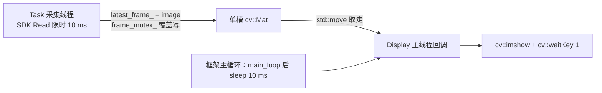

# 相机帧源与订阅者解耦规划

日期：2026-10-13。

对象：`project/thread/camera/trd_camera.cpp` 的帧交付、主线程 `Display()`、以及相机线程自身的等待粒度。

状态：**规划，代码未动。** 第 2 节的实测格要先量。

## 1. 依据来源与边界

参照实现：`temp/Dust_infantry_vision-main`（同一套 HikRobot 采集流程的来源工程）。

**从它拿的：**

| 结构事实 | 出处 |
| --- | --- |
| 发布接口只做"订阅判断 + 限流 + 入队"，缩放与 JPEG 编码在内部线程做，不占主循环 | [foxglove_vision.hpp:53-55](../temp/Dust_infantry_vision-main/visualization/foxglove_vision.hpp#L53-L55) |
| 待发图像只保留一帧，新帧覆盖时计数 `dropped_images_`，不排队 | [foxglove_vision.cpp:238](../temp/Dust_infantry_vision-main/visualization/foxglove_vision.cpp#L238) |
| 队列有界且丢最旧（`image_backlog=2`、`data_backlog=4096`），慢消费者不让时延无限增长 | [foxglove_vision.hpp:24-25](../temp/Dust_infantry_vision-main/visualization/foxglove_vision.hpp#L24-L25) |
| 无人订阅、也不开本地窗口时不保留检测源帧 | [auto_aim_runtime.cpp:523-525](../temp/Dust_infantry_vision-main/src/auto_aim_runtime.cpp#L523-L525) |
| 旁路线程主动降级让 CPU：图像线程 `SCHED_IDLE`，数据线程只降 `nice 19`，生效值要能读出来 | [foxglove_vision.cpp:312-349](../temp/Dust_infantry_vision-main/visualization/foxglove_vision.cpp#L312-L349) |
| 相机线程只做"取一帧 + 快照姿态 + 提交给下游"，不画、不编码、不判停 | [auto_aim_runtime.cpp:464-521](../temp/Dust_infantry_vision-main/src/auto_aim_runtime.cpp#L464-L521) |
| 主线程**阻塞等结果**（`wait_pop_for(50 ms)`），有结果才绘制与显示，不是固定节拍轮询 | [auto_aim_runtime.cpp:522-604](../temp/Dust_infantry_vision-main/src/auto_aim_runtime.cpp#L522-L604) |
| 本地窗口与远端通道**共用同一份叠加绘制**，只画一次 | [auto_aim_runtime.cpp:583-595](../temp/Dust_infantry_vision-main/src/auto_aim_runtime.cpp#L583-L595) |
| 每秒一条分段计时日志（capture/submit/inference:wait+postprocess/delivery）+ **按原因分类**的丢帧计数 | [auto_aim_runtime.cpp:535-545](../temp/Dust_infantry_vision-main/src/auto_aim_runtime.cpp#L535-L545) |
| **"等设备"被关在驱动内部的采集线程里**：SDK 等待只用 100 ms 超时，转换完入容量为 1 的队列，对外 `read()` 是 `queue_.wait_pop()` 阻塞 | [hikrobot.cpp:137-197](../temp/Dust_infantry_vision-main/io/hikrobot/hikrobot.cpp#L137-L197)、[:61-71](../temp/Dust_infantry_vision-main/io/hikrobot/hikrobot.cpp#L61-L71) |
| 驱动内另有一条 daemon 看护线程：每 100 ms 查一次采集线程是否还活着，死了就退避 1 s 重启采集 | [hikrobot.cpp:22-42](../temp/Dust_infantry_vision-main/io/hikrobot/hikrobot.cpp#L22-L42) |
| 连续 10 次 no-data 才判故障退出采集线程；`stop()` 靠 `queue_.close()` 唤醒阻塞中的 `read()` | [hikrobot.cpp:152-158](../temp/Dust_infantry_vision-main/io/hikrobot/hikrobot.cpp#L152-L158)、[:55-58](../temp/Dust_infantry_vision-main/io/hikrobot/hikrobot.cpp#L55-L58) |

**与它的关键取舍差异（三条）：**

1. **它没有多订阅者，因为它只有一条链。** 图像从相机直通检测器（`submit` 带自增序号、异步推理、`wait_pop` 按序号有序交付），识别**就是主链本身**，显示和远端都挂在主线程那一站的后面。本文要支持"同一条相机喂两个各自节奏的消费者"，所以选**帧源 + 共享最新帧槽 + 多订阅者**；它那套有序异步交付是识别内部的事，不照搬。
2. **它给每个订阅者各有界队列；本文用共享槽。** 消息语义是"最新状态"而不是"必须逐条处理的事件"——共享槽内存只有一份、天然丢最旧、实现更小。理由与退路见 §5.1。注意它的 `wait_pop` 是**取走即消失**，只能有一个消费者，**不能照抄**。
3. **它把采集线程塞进驱动内部；本文的线程一律走 `REGISTER_THREAD`。** 它没有统一注册与关闭机制，只能自己起线程、自己在析构里 join。本工程的线程生命周期是框架契约（[Init_entry.cpp:251-276](../framework/init/Init_entry.cpp#L251-L276)），照它那样在模块里偷偷起线程会绕开这条契约——要摘出设备等待，方式见 §5.4。

**不拿的：** Foxglove C++ SDK 与 WebSocket 端口体系、nlohmann JSON 遥测、OpenVINO/YOLO 推理链、它的 YAML 分段与命令行迁移方式。

**本文范围外：** 识别算法本身、相机 SDK 的调用语义（`Read` 的数据路径不动）、远端传输（见 §8）。

## 2. 现状：链路与数字



**一个已确认的环境事实：** 本机 OpenCV 4.6.0 的 highgui 后端是 **Qt5**（`libopencv_highgui.so` 链 `libQt5Widgets`/`libQt5Gui`）。Qt 的窗口对象只能在**主线程**创建和操作，所以 `imshow`/`waitKey` 是**挪不出主线程**的——这决定了改造方向是"把别的东西挪出去"而不是"把显示挪出去"。

能直接算出来的（代码推导，不需实测）：

| 量 | 算式 | 结果 |
| --- | --- | --- |
| 主循环频率 | `1 / (t_display + 10 ms)` | `t_display = 1 ms` → **91 Hz**；`3 ms` → **77 Hz** |
| 主循环空转比例 | `1 − f_camera / f_loop` | 30 fps / 80 Hz → **每 3 轮有 2 轮没有新帧**，但 `waitKey` 照跑 |
| `waitKey(1)` 下限开销 | `f_loop × 1 ms` | 80 × 1 ms = **≥ 8% 的主线程时间**，与帧率无关 |
| 单槽交付丢帧率 | `max(0, 1 − T_p / T_c)`，`T_p`=帧间隔、`T_c`=消费者耗时 | `T_p = 33 ms`、`T_c = 40 ms` → **丢 17%** |
| 相机线程无帧时的唤醒节拍 | `1 / timeout_ms` | `timeout_ms: 10` → **100 Hz**；改 100 ms → **10 Hz** |

**空闲时到底谁在醒（这是全文的总账）：**

| 唤醒源 | 节拍 | 性质 |
| --- | --- | --- |
| 消费者（识别等） | **0** | 设计目标，§4 第 3 条 |
| 主线程显示回调 | 20 Hz（50 ms 超时） | 有理由的例外：要泵 Qt 事件，§5.2 |
| 框架主循环 `System_WaitForStop` | **100 Hz** | 遗留，§8 划在范围外 |
| 相机线程"等设备" | **100 Hz** | §5.4 处理（不算空转，是在等 SDK） |

必须实测填入：

```bash
pid=$(pgrep -x vision_app)
mid=$pid                                                     # 主线程 TID 等于 PID
cid=$(grep -l '^camera$' /proc/$pid/task/*/comm | cut -d/ -f5)

grep ctxt /proc/$pid/task/$cid/status     # 60 s 增量 ≈ 有效帧数 + 超时次数 → 反推实际帧率
awk '{print $14+$15}' /proc/$pid/task/$mid/stat   # 主线程 CPU 时间，单位 tick
```

| 指标 | 实测值（待填） | 说明 |
| --- | --- | --- |
| 相机实际帧率 | | `frame_rate: 30` 是请求值（[trd_camera.yaml](../project/thread/camera/trd_camera.yaml)），受曝光/USB 限制 |
| 图像分辨率 | | 运行时从 SDK 取，配置里没有；用来算帧字节数与内存上界 |
| `t_display`（`imshow` + `waitKey` 单次耗时） | | 有窗口才计 |
| 主线程 60 s `utime+stime` 增量 | | 开窗口 / 关窗口各一次，差值就是 highgui 的常数开销 |
| 相机线程无帧时 60 s 切换增量 | | 断线态下测，用来核对 §5.4 改前改后 |

## 3. 差距与病灶

**① 出口只有一个消费者，而且是 UI。** 帧的唯一去处是 `Display()`（[:217](../project/thread/camera/trd_camera.cpp#L217) 取走、[:227](../project/thread/camera/trd_camera.cpp#L227) 画）。识别线程拿不到：`latest_frame_` 是文件内 `static`。

**② 显示被绑死在主循环的 10 ms 节拍上。** 主循环是"`Display()` 然后固定 sleep 10 ms"，所以它按 80~90 Hz 跑，而新帧只有 30 Hz：**约 2/3 的轮次是空转**，每轮却照样执行 `waitKey(1)`（≥1 ms，§2 算出 ≥8%）。显示需要的不是高频率，是"有新帧才画"。

**③ 交付语义没定。** 单槽覆盖写没有帧序号、没有时间戳传递、没有丢帧计数。丢最旧本身是对的策略，但它是隐含行为而非契约，接第二个消费者时会踩。

**④ 没有"没人看就别做"的开关。** 参考工程在无人订阅、也不开窗口时不保留源帧；我们无论跑识别还是无人值守，窗口都建着、`waitKey` 都在跑。注意这条的修法不是"加个开关"就完了——**决定权应该在消费侧**（订阅者每轮声明自己还要不要），帧源不猜，见 §5.1。

**⑤ "等设备"发生在业务循环里。** 相机线程自己调 [hikrobot.cpp:297](../framework/modules/camera/hikrobot.cpp#L297) 的 `MV_CC_GetImageBuffer(handle_, &raw, timeout_ms_)`，`timeout_ms: 10` 意味着**没有帧时业务循环按 ~100 Hz 醒来调一次 SDK**。这不是空转（它在等 SDK 返回），但和 §2 里主循环那条是同一个量级，而且它把"设备 I/O 的节奏"混进了业务循环——同一条循环里还夹着 `ExecuteCommand()`（shell 调参）。

## 4. 方法学约束

1. **`imshow`/`namedWindow`/`waitKey` 只在主线程**。本机 highgui 是 Qt5（§2），这不是风格偏好。
2. **相机线程的取帧周期是硬约束**：任何消费者慢都不能反压到相机，交付只允许"入槽即返回"。
3. **消费者线程只在有数据时被唤醒，其余时刻真阻塞。** 不许用固定周期轮询取帧——那等于把 §3② 的毛病复制到每一个订阅者身上。唤醒源只有两个：**新帧**、**停止请求**；后者是 `System_Shutdown` 能把线程 join 回来的前提（同 [调试台线程 CPU 空转](调试台线程CPU空转问题与修改方案.md) 里 `RequestStop` 要一并唤醒的处理）。唯一允许带周期超时的是主线程的显示回调，理由见 §5.2。
4. **有界 + 丢最旧**，且丢帧必须可观测（不许静默）。
5. **不许 `clone()`**：`cv::Mat` 赋值是引用计数浅拷贝，是共享像素的唯一前提（§5.1）。
6. **线程一律走注册机制**（`REGISTER_THREAD` + `System_Shutdown` 的 request_stop/join）。模块不自己起线程——这是本工程与参照实现的根本差异之一（§1 第 3 条）。
7. **降级让路要回显**：若做旁路线程，`SCHED_IDLE`/nice 可能因权限失败，失败按"没降级"处理并记录下来，不回退成错误退出。

## 5. 分步骤

### 步骤 1：相机只做帧源，交付改成"最新帧槽 + 序号 + 新帧唤醒"

**做什么：** 相机线程只做 `Read → Publish → 下一帧`。帧交付从文件内 `static cv::Mat` 变成一个有界通道：**一个"最新帧"槽 + 全局单调序号 + 条件变量**，订阅者各自持有"我取到哪一帧"的序号。

**落点（按子树 topic 层来）：**

| 文件 | 内容 |
| --- | --- |
| `framework/topic/channel.hpp` | 通用发布订阅机制：`template <typename Message> class Channel` + `class Subscriber`，对应子树的 zbus 通道 |
| `framework/topic/camera_to/camera_to.hpp` | 相机话题：`namespace topic::camera_to` 里的 `Message` + `extern Channel<Message> pub_camera_to`（对应 `ZBUS_CHAN_DECLARE(pub_camera_to)`） |
| `framework/topic/camera_to/camera_to.cpp` | 通道实例定义（对应 `ZBUS_CHAN_DEFINE`） |
| `framework/CMakeLists.txt` | `framework_topic` 从 INTERFACE 改成 STATIC：通道实例要有编译单元，否则链接期找不到符号 |

**订阅者不放在话题层**：子树在通道旁定义一个共享观察者（`ZBUS_SUBSCRIBER_DEFINE(sub_xxx_to)`），这里不那样做——显示与识别要各自独立取帧，共用观察者会互相抢消息。**每个消费者在自己的线程文件里声明 `Subscriber`**（如相机线程的 `sub_camera_to`），符合"状态声明在拥有它的线程"这条规矩。头文件里不放全局实例、不放单例访问函数。

**接口形状：**

```cpp
namespace topic
{
template <typename Message>
class Channel
{
public:
    void Publish(Message message);      // 覆盖槽内旧消息并唤醒订阅者，只由数据拥有者调用
    void Close();                       // 唤醒所有等待者，等待返回 false
    void Clear();                       // 释放槽内消息（保留序号，置无效）
    std::uint64_t Published() const;    // 已发布条数
};

template <typename Message>
class Subscriber
{
public:
    explicit Subscriber(Channel<Message>& channel);  // 在线程里声明，构造只存引用
    bool Wait(Message& message);                     // 消费主入口：阻塞到新消息或通道关闭
    bool TakeLatest(Message& message);               // 非阻塞：只给"已经因别的原因醒来"的调用方
    void AlignToLatest();                            // 中途加入：跳过已有消息
    std::uint64_t Taken() const;                     // 本订阅者取到条数
    std::uint64_t Dropped() const;                   // 本订阅者被覆盖掉的条数
};
}

namespace topic::camera_to
{
struct Message
{
    cv::Mat image;                                    // 浅拷贝：像素由引用计数共享
    std::chrono::steady_clock::time_point timestamp;  // 相机 SDK 的帧时间戳
};
extern Channel<Message> pub_camera_to;                // 相机线程发布
}
```

**算法与公式：**

- **取走不清空**。`Wait` / `TakeLatest` 返回时把槽里的消息复制给调用方（大对象是浅拷贝）并推进**该订阅者自己的游标**，槽本身保持不变。因此每个订阅者都能独立读到同一条最新消息，谁先取谁后取互不影响，内存始终只有**一份**。
- 丢帧由 `Subscriber` 自己记：`Dropped()` 统计"游标跨过去的条数"（`新序号 − 旧序号 − 1`），`Taken()` 统计取到的条数。通道只管发布计数，避免"多个订阅者谁算丢"的歧义。
- **中途加入的订阅者先调 `AlignToLatest()`**，否则第一次调用会立刻拿到槽里已有的消息（从 0 开始只适合"启动就要显示当前画面"的显示订阅者）。这条是步骤 1 的行为自检跑出来的。
- 通用化时踩到的一个坑：`Clear()` 用 `Message{}` 清槽，而通用消息类型没有"空值"概念，订阅者会把空槽当成新消息。通道因此多一个 `valid_` 标志，由 `Clear()` 置无效——`TakeLocked` 同时判序号和有效性。
- 槽数为什么是 1：图像语义是"最新状态"，30 fps 下识别本来追不上，丢最旧天然正确；单槽把内存和延迟都压到最小（最坏交付延迟 = 1 个帧间隔）。若某个订阅者真需要"一帧不漏"（例如落盘录像），它才需要自己的有界队列，容量按 `N ≥ ceil(T_c / T_p)`：

| 消费者耗时 `T_c`（`T_p = 33 ms`） | 单槽丢帧率 | 若改用队列所需 `N` |
| --- | --- | --- |
| 10 ms | 0% | 1 |
| 20 ms | 0% | 1 |
| 40 ms | 17% | 2 |
| 60 ms | 45% | 2 |

- **唤醒源只有两个：新帧、停止请求**，用条件变量实现（不用 eventfd：消费者没有 fd 集合要一并 poll，与 [调试台线程 CPU 空转](调试台线程CPU空转问题与修改方案.md) 里 shell 线程的情形不同）。消费者默认**不带超时**：`WaitFrame(frame, seq)` 无帧就一直阻塞。`RequestStop` 必须一并通知，否则 `System_Shutdown` 的 `join` 会挂在它身上。
- **`TakeLatest` 不给业务消费者用**：它只服务于"这次醒来是因为别的原因"的调用方（比如某条线程同时要 poll stdin 与取帧）。业务消费者循环里出现固定周期的取帧调用，就把 §3② 的毛病复制到了每个订阅者身上。
- **安全性依据**：`HikRobot::Read` 每帧都是新建的 `cv::Mat`（局部 `cv::Mat bgr(...)` 再 move 出来），`Publish` 只做浅拷贝赋值，所以下一个 `Read` 不会改写别人正在看的像素；旧帧由最后一个释放者回收。
- **内存上界** = 一份帧 + 各订阅者手里的引用（同一块内存）。1080p BGR ≈ 6 MB/帧，两订阅者不 clone 时总占用仍是一份。
- **"谁要帧谁声明"**（借参考工程 `set_keep_source` 的做法，[auto_aim_runtime.cpp:523-525](../temp/Dust_infantry_vision-main/src/auto_aim_runtime.cpp#L523-L525)）：有成本的动作要不要做，由**消费侧每轮声明**，帧源不猜。步骤 1 里相机无条件 `Publish`（浅拷贝，成本可忽略）；真正需要这个开关的是步骤 3 的旁路绘制。

**验收数字：**
- 用 40 ms 周期的测试订阅者跑 60 s：它按自己的节奏取到最新帧，取到的帧数 ≈ `min(相机帧数, 60 s / 40 ms)`；同一条件下单槽覆盖行为应表现为丢帧率 ≈17%（对照组）。
- 帧序号全局单调递增、无重复、无回退；`timestamp` 来自 SDK 帧时间戳而不是取帧时刻。
- 改造前后采集线程 `Read` 调用周期分布不变：p99 偏差 < 10%。
- **可观测性照参考工程的分段计时做法**（[auto_aim_runtime.cpp:535-545](../temp/Dust_infantry_vision-main/src/auto_aim_runtime.cpp#L535-L545)）：每秒一条日志给出 `Publish` 间隔、`Published()` 总数、每个订阅者的取帧数与丢弃数，**丢弃要分原因**（"来不及取被覆盖"与"本来就没有新帧"分开计）。
- **阻塞质量**：没有新帧时，消费者的 `voluntary_ctxt_switches` 60 s 增量应 **< 10**；相机断线重连期间也一样。这是"真阻塞"和"定时唤醒"的分界（口径同 §2）。

```bash
cid=$(grep -l '^<消费者线程名>$' /proc/$pid/task/*/comm | cut -d/ -f5)
grep ctxt /proc/$pid/task/$cid/status     # 无帧状态下 60 s 增量
```

**失败分叉：**
- 采集线程周期 p99 变差 > 10% → 查 `Publish` 是否发生了像素拷贝（必须只赋值 `cv::Mat` 头，**绝不许 `clone()`**）。
- 订阅者取到的帧数远低于预期 → 先确认它在用 `WaitFrame` 而不是自己重开相机；再看 §2 ① 的实际帧率。
- 订阅者反复处理同一帧 → 它没更新 `last_sequence`。
- 退出挂住 → `RequestStop` 有没有通知条件变量。

### 步骤 2：显示变成主线程上的订阅者（把轮询换成等帧）

**做什么：** 保留 `Display()` 在主线程，但**把它从"每 10 ms 空跑一次"改成"等新帧或超时才醒"**：`WaitFrame(frame, last_sequence, 50 ms)` → 有新帧才 `imshow` → 每次都 `waitKey(1)` 泵一次 Qt 事件。

**为什么显示不能挪出主线程：** §2 已确认 highgui 走 Qt5，`imshow`/`waitKey` 的工作是"往 QWidget 上画 + 泵 Qt 事件循环"，Qt 要求这些调用发生在创建 `QApplication` 的线程即主线程。挪到工作线程的典型后果是断言失败、窗口不刷新或直接崩溃——**加锁解决不了**。要"显示不占主循环"，只能靠旁路成品图（步骤 3）或换出口（§8），不是换线程。

**能挪出去的是什么：** 主循环里**除 `imshow`/`waitKey` 以外的一切**——绘制、缩放、编码都是纯 `cv::` 计算，与 GUI 无关（见步骤 3）。

**参考工程的主线程就是这个形状**：它阻塞在 `detector.wait_pop_for(50 ms)` 上，拿到结果才绘制显示（[auto_aim_runtime.cpp:522-604](../temp/Dust_infantry_vision-main/src/auto_aim_runtime.cpp#L522-L604)）——**等，而不是轮询**。差别只在于它等的是检测结果，我们等的是新帧。

**落点：** 显示从相机线程里**拆成独立线程模块** `project/thread/display/`（`trd_display.cpp` + `trd_display.yaml`），避免窗口语义污染相机语义：

- `trd_display.cpp`：订阅 `camera_to`，在**主线程回调**里 `Wait(message, wait_ms)` → 有帧才 `imshow`，每轮 `waitKey(1)` 泵 Qt 事件；`show_window` 为假时不注册回调、不碰 highgui。
- `trd_display.yaml`：`show_window`（**启动初值**）、`wait_ms` 归显示自己（原来挂在相机 YAML 上的 `show_window` 移过来）。
- **运行期开关用 shell 变量 `display.show`（0=不显示，1=显示），默认显示**：var 的 `setter` 在 shell 线程只改请求标志并唤醒主线程，窗口的创建/销毁仍落在主线程回调里（Qt 约束）。主线程回调常驻（否则 var 打开时没人建窗口）。
- `project/thread/CMakeLists.txt`：源文件加入 `vision_app`，yaml 用 `configure_file(... COPYONLY)` 部署到二进制旁的 `thread/display/`。
- 相机线程只留发布：不再注册主线程回调、不再引用 highgui（`#include <opencv2/highgui.hpp>` 和 `System_startup.hpp` 都去掉）。

**注意主线程回调槽只有一个**（[Init_entry.cpp](../framework/init/Init_entry.cpp) 的 `main_loop`），谁注册谁持有——相机线程让出来之后由显示模块独占，不要让两个模块都注册。

**算法与公式：**

```
唤醒频率 = max(相机帧率, 1 / 超时)          # 超时只为泵 GUI 事件，防止窗口"无响应"
waitKey 开销 = 唤醒频率 × 1 ms
```

- 相机 30 fps、超时 50 ms → 唤醒 30 Hz → `waitKey` 开销 **≈3%**（改造前 ≥8%，§2）。
- **这个超时是 §4 第 3 条里唯一允许的例外**，理由只有一个：Qt 的事件循环必须有人泵，不泵则窗口点关闭没反应，相机断线重连（最长 `max_frame_gap_ms = 3000 ms`）期间窗口会假死。除主线程的显示回调，任何消费者都不许带周期超时；识别线程用无超时的 `WaitFrame`。
- 超时时间内不允许再做别的事，`Display()` 里除了 `imshow`/`waitKey` 不出现像素计算。
- `show_window: false` 时不注册主循环回调、不建窗口（参考工程同位置的做法，[auto_aim_runtime.cpp:598-602](../temp/Dust_infantry_vision-main/src/auto_aim_runtime.cpp#L598-L602)）。

**验收数字：**
- 开窗口时主线程 60 s `utime+stime` 增量相对改造前下降，降幅与"唤醒频率从 80 Hz 降到 30 Hz × 1 ms"的量级一致。
- 空闲轮次不再执行 `waitKey`：30 s 内 `waitKey` 调用次数 ≈ 帧数 + 超时次数。
- `show_window: false` 全程 `cv::imshow`/`cv::waitKey` 调用次数 = **0**（计数桩验证，不靠"没看见窗口"）。
- 相机断线重连期间窗口仍能响应关闭（超时在起作用）。

**失败分叉：**
- 窗口卡住不响应 → `WaitFrame` 的超时是不是被写成无限等待。
- `waitKey` 次数不降 → `Display()` 里是否还有别的地方在重复画。
- 关窗口后仍有 highgui 调用 → 查 `Release()` 的 `window_open_` 保护与注销顺序。

### 步骤 3：绘制与编码挪到旁路线程（**条件触发，先不做**）

**触发条件：** 需要远端查看、需要录像，或实测 `t_display` 超过帧间隔的 20%。

**做什么：** 识别所需的叠加、ROI 框、准星等绘制放到旁路线程，产出**成品图**放进第二个槽；主线程只负责 `imshow` 成品图。相机线程与主线程都不做像素计算。

**落点：** `framework/topic/` 下再起一个话题（如 `overlay_to`，成品图与检测结果各一条），照 §5.1 的目录约定；发布线程用 `REGISTER_THREAD` 注册（§4 第 6 条）。

**算法与公式：** 与 §1 表里参考工程那条一致：旁路线程 `SCHED_IDLE` 降级、失败退回 `nice 19`，实际生效策略必须可读出；被抢占时表现为画面帧率下降，不拖慢帧源与识别。

**验收数字：** 主循环里不再出现像素操作（grep `cv::` 只有 `imshow`/`waitKey`）；旁路线程的调度策略可从日志读出；相机帧交付数不受旁路影响。

### 步骤 4：把"等设备"从业务循环里摘出去（**独立，建议先做**）

与步骤 1~3 无依赖，可以任何时候做，且第一步只改一个数。

**现状：** 相机线程自己在循环里调 [hikrobot.cpp:297](../framework/modules/camera/hikrobot.cpp#L297) 的 `MV_CC_GetImageBuffer(..., timeout_ms_)`，`timeout_ms: 10`（[trd_camera.yaml](../project/thread/camera/trd_camera.yaml)）→ 无帧时业务循环 ~100 Hz 醒。同一条循环里还夹着 `ExecuteCommand()`。

**参考工程怎么做的：** 把设备等待关进驱动内部——采集线程自己跑 `MV_CC_GetImageBuffer(..., 100 ms)` 并把结果推入容量 1 的队列（[hikrobot.cpp:137-197](../temp/Dust_infantry_vision-main/io/hikrobot/hikrobot.cpp#L137-L197)），对外的 `read()` 只是 `queue_.wait_pop()` 阻塞（[:61-71](../temp/Dust_infantry_vision-main/io/hikrobot/hikrobot.cpp#L61-L71)）。**它并没有消灭设备轮询**，只是把粒度放粗到 10 Hz 并隔离进了驱动。注意它那份驱动另有 daemon 看护线程与 `queue_.close()` 的停止方式，这些**不照搬**（§1 第 3 条）。

**4.1 先做这个（一行）：** `timeout_ms: 10` → `100`。

| 代价 | 现在 | 改后 |
| --- | --- | --- |
| 相机线程无帧时唤醒 | ~100 Hz | ~10 Hz |
| 停止响应（`thread_stop` 到 `Task` 退出） | ≤10 ms | ≤100 ms |
| shell 调参生效延迟（`ExecuteCommand` 与 `Read` 同循环） | ≤10 ms | ≤100 ms |
| **帧交付延迟** | 帧到即返回 | **不变**（超时只在没有帧时计时） |
| 断线判定（`max_frame_gap_ms: 3000`） | 不变 | 不变 |

两项代价都是人感知不到的尺度，收益是空闲唤醒少一个数量级。

**4.2 条件触发，先不做：** 当"业务循环里混着设备 I/O"本身开始碍事时（比如取帧节奏被 SDK 返回时机牵着走，或循环里还要塞别的事），改成**在 `project/thread/` 用 `REGISTER_THREAD` 起一条采集线程**，模块仍是纯设备包装、`Read` 保持短超时——**不在 `framework/modules/camera/` 里起线程**（§4 第 6 条）。

**验收数字：** 断线态下相机线程 60 s 切换增量从 ~6000 降到 ~600；正常取帧时**帧交付延迟与帧率不变**（实测对比改造前后同一场景的 fps 与帧间隔 p99）；停止延迟实测 ≤ 100 ms + 一次像素转换。

**失败分叉：**
- 帧率掉了 → 先看是不是把超时改到了大于帧间隔（`100 ms > 33 ms` 没关系，但别写成 1000）。
- 停不下来 → `Task` 里 `Read` 之后的 `StopRequested()` 检查必须保留（[:360](../project/thread/camera/trd_camera.cpp#L360)）。
- 调参变慢到不可用 → 说明命令槽与取帧耦合太重，该做 4.2 了。

## 6. 顺序为什么不能换

- **步骤 1 必须在 2 之前**：交付语义（槽、序号、时间戳、丢帧口径）是"谁在消费"的前提。先做显示改造，识别仍然拿不到帧。
- **步骤 1 必须在接入识别之前**：识别一旦绑到文件内 `static` 的 `latest_frame_`，再改交付就要连识别侧一起改。
- **步骤 3 依赖 1 和 2**：旁路要有帧源才能拿帧，要知道"谁在画"才知道成品图交给谁。
- **步骤 4 与 1~3 无关**，可以并行甚至先行（改一个数、零风险），但它**不改变交付语义**——别指望它顺带解决多消费者的问题。

## 7. 失败回退表

| 症状 | 先查 | 最后才查 |
| --- | --- | --- |
| 采集线程帧率掉了 | `Publish` 是否发生像素拷贝（只能赋值 `cv::Mat` 头） | `Read` 超时是否变多（§2 ①） |
| 识别拿到的帧比相机少很多 | 它是否用 `Subscriber` 的游标取最新帧、`AlignToLatest()` 有没有调 | `Published()` 与 `Taken() + Dropped()` 的差值 |
| 消费线程空闲时唤醒数不为 0 | 它是不是写成了周期取帧 | `RequestStop` 是否只通知了条件变量的一侧 |
| 关窗口后主线程占用没降 | 主循环回调是否已注销 | 是否还有别的 `cv::` 调用在工作线程 |
| 窗口假死 / 点关闭没反应 | `WaitFrame` 超时是否被改成无限 | Qt 事件是否还有别处在泵 |
| 相机线程空闲唤醒没降 | `timeout_ms` 是否真的生效（日志或配置回显） | 断线重连路径里的 `WaitForStop(1000 ms)` 节拍 |
| 退出时挂住 | 窗口销毁是否在主线程（`Release` 是 cleanup 回调） | 旁路线程 join 是否排在 `camera_.Stop()` 之前 |
| 说不清延迟或丢帧出在哪一段 | 先按 §5.1 补分段计时与分类丢帧计数 | 再回头怀疑交付结构本身 |

## 8. 明确不做的部分

1. **不把 `imshow`/`waitKey` 挪出主线程**：本机 highgui 是 Qt5，Qt 的 GUI 只能在主线程（§2、§5.2）。
2. **不用 SDK 的图像回调**（`MV_CC_RegisterImageCallBackEx` 一类）：收益是根本没有"等设备"，代价是像素处理跑进 SDK 的线程上下文、停止时机变绕（回调还在跑时怎么保证句柄不被销毁）。而且本机没有 MVS SDK，签名无法验证——**不碰**。
3. **不在模块里起线程**：设备等待要摘出去就按 §5.4.2 在 `project/thread/` 走 `REGISTER_THREAD`，不学参照实现把线程塞进驱动（§4 第 6 条）。
4. **不引 Foxglove SDK**：远端可视化是独立需求。真要远端，接口应该是"第二个槽 + 一个发布线程"，与本文的帧通道同构。
5. **不改 `hikrobot.cpp` 的数据路径**：`Read` 的像素转换、`Stop`/`Reopen`/重连语义保持现状（见 [HikRobot断线重连机制](HikRobot断线重连机制.md)）；步骤 4 只动超时值。
6. **不复用日志那套队列**：帧通道与日志帧池是两套东西，日志这套已定稿（[调试台线程CPU空转问题与修改方案](调试台线程CPU空转问题与修改方案.md)）。
7. **不改框架主循环那 10 ms**：它是 §2 表里最后一个 100 Hz 空闲源，同一个毛病的另一处（等的是 `stop` 标志，不是帧）。本文不处理；要做的话方式与 shell 线程那次的 eventfd 改造同构，单独开一份。
