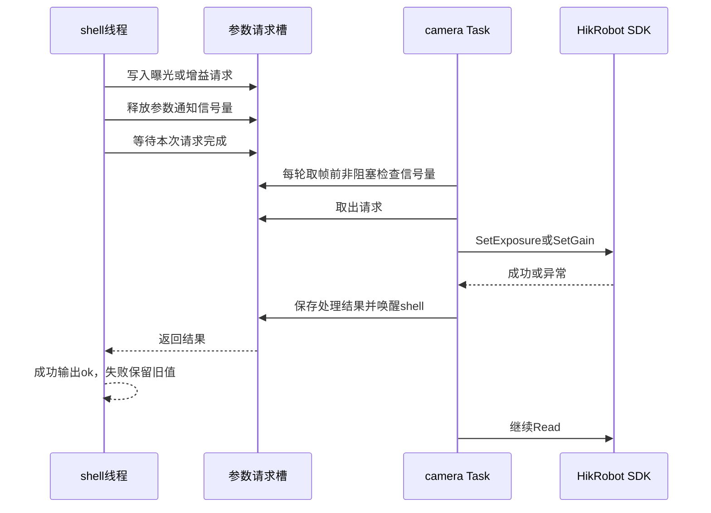

# 相机运行时线程内调参规划

## 1. 目标

解决相机连续采集时执行以下命令反复返回 `device busy, retry` 的问题：

```text
var set camera.exposure_us 50000
var set camera.gain_db 6
```

改造后由相机采集线程统一执行所有运行期 SDK 操作。shell 线程只提交参数请求并等待处理结果，不再与采集线程争抢相机设备锁。

本次只调整运行期曝光和增益设置链路，保留现有 Dust 注册入口、相机初始化、取帧、显示、断线恢复和关闭顺序。不新增调参线程，不自动修改 YAML，不改变现有命令名称和参数单位。

**实施状态（2026-10-13）：核心改造已完成。** `dust build -p` 通过；实机连续采集期间曝光 `50000 μs` 和增益 `6 dB` 设置成功，查询值正确，未再出现 `device busy, retry`。参数提交期间 SIGTERM 已验证可取消等待并正常 Join。调参过程中拔线及重连后的再次设置仍待实机专项验证。

## 2. 当前问题

当前采集线程在每次取帧期间持有 `camera_access_`：

```text
获取 camera_access_
    ↓
等待 SDK 图像
    ↓
转换 BGR 图像
    ↓
归还 SDK 缓存
    ↓
释放 camera_access_
    ↓
立即开始下一轮并再次获取 camera_access_
```

通知型 var 也要先取得同一个 `camera_access_`，随后才会调用 `SetExposure()` 或 `SetGain()`。采集线程释放锁后会立即进入下一轮，shell 在 200 ms 内可能一直得不到执行机会，于是设置函数尚未接触 SDK 就返回 `device busy, retry`。

这不是相机不支持运行中调参，也不是输入值越界。当前实机已读取曝光范围 `[15, 9999813] μs`，`50000 μs` 位于有效范围内。

## 3. 目标执行关系



关键约束如下：

1. 运行期只有相机 Task 调用相机 SDK。
2. 参数信号量只表示“存在待处理请求”，不再承担设备互斥。
3. shell 必须等到 SDK 返回后才能输出 `ok`。
4. SDK 设置失败时，var 当前值和重连配置都保留上一次成功值。
5. 请求处理不能阻塞正常停止，关闭期间等待中的 shell 必须被唤醒。

## 4. 请求模型

当前 shell 只有一个命令处理线程，同一时刻只会执行一条 `var set`，因此使用单请求槽即可，不建立通用命令队列。

请求槽保存以下状态：

```cpp
enum class CameraParameter
{
    Exposure,
    Gain
};

struct ParameterRequest
{
    CameraParameter parameter;
    double value;
    bool pending;
    bool executing;
    bool completed;
    std::exception_ptr error;
};
```

该结构包含请求类型、数值和同一事务的状态，字段具有共同生命周期，使用结构体是为了保证一次请求的状态不会被拆散。它与此前只有一个字段的 `Params` 不同。

配套同步对象放在 `project/thread/camera/trd_camera.cpp`：

- 一个互斥锁保护请求槽。
- 一个初值为 0 的信号量通知相机 Task。
- 一个条件变量把 SDK 处理结果返回给 shell。

请求槽只允许存在一条未完成请求。以后如果出现多个命令生产者，再单独评估固定容量队列；本阶段不提前加入多生产者设计。

## 5. 信号量职责调整

### 5.1 现有职责

`Semaphore` 当前固定以 1 初始化，通过 `Guard` 作为设备互斥锁使用。

### 5.2 目标能力

在 `framework/init/semaphore.hpp` 增加两项最小能力：

1. 构造时允许指定初值，默认值仍为 1，现有互斥用法不变。
2. 增加不阻塞的 `TryAcquire()`，内部使用 `sem_trywait()`；没有信号时返回 `false`，其他系统错误抛异常。

相机参数通知使用：

```cpp
static Semaphore parameter_signal_ {0};
```

shell 每提交一条请求只执行一次 `Release()`。相机 Task 每轮取帧前执行一次非阻塞 `TryAcquire()`。shell 在请求完成前不会提交下一条命令，因此信号计数不会无上限累积。

相机 Task 不得阻塞等待参数信号，否则没有调参命令时会停止取帧。

## 6. var 通知语义调整

当前 `SetNotifiedValue()` 在持有条目互斥锁期间调用业务 setter。新方案中 setter 需要等待相机线程处理，如果继续持有参数锁，相机线程更新成功参数时会发生死锁。

通知型 var 改为以下顺序：

1. 持有条目锁，检查动态范围有效性并钳制候选值。
2. 保存候选值后释放条目锁，但暂不修改当前成功值。
3. 调用业务 setter，等待相机 Task 返回 SDK 结果。
4. setter 成功后重新取得条目锁，提交当前成功值。
5. setter 抛异常时不修改原值，由 shell 输出异常文本。

普通 `REGISTER_SHELL_VAR` 和 `REGISTER_SHELL_VAR_RANGE` 保持原有直接写入行为。

当前只有相机使用通知型 var。完成线程内调参后，`VarEntry::access`、`VarAccess()` 以及通知宏末尾的可选设备信号量参数不再承担实际职责，应一起删除，避免保留两套互斥路径。

目标注册形式为：

```cpp
REGISTER_SHELL_VAR_RANGE_NOTIFY(
    "camera.exposure_us",
    camera_.GetParameters().exposure_us,
    camera_.GetParameters().exposure_min_us,
    camera_.GetParameters().exposure_max_us,
    camera_.GetParameters().mutex,
    SetExposureFromVar,
    &camera_);
```

## 7. shell 提交请求

`SetExposureFromVar()` 和 `SetGainFromVar()` 不再直接调用 `HikRobot` SDK 接口，而是共同调用一个内部提交函数。

提交过程如下：

1. 检查线程是否正在停止。
2. 取得请求锁，确认请求槽为空。
3. 写入参数类型和候选值，清空上一次结果。
4. 将请求标记为 `pending`，释放一次参数信号量。
5. 使用条件变量等待 `completed` 或停止取消。
6. 成功时返回；失败时重新抛出相机线程保存的异常。

等待条件必须使用谓词，不能依赖一次通知，避免虚假唤醒。等待条件变量时会自动释放请求锁，不会妨碍相机 Task 取得请求。

本阶段不设置任意的 200 ms 抢锁时限。请求通常会在下一次采集循环开始前处理；停止流程负责取消等待。如果 SDK 设置接口本身长期不返回，属于 SDK 调用上界问题，应单独处理，不能通过请求等待超时伪装成设置未发生。

## 8. 相机 Task 处理请求

在 `Task()` 每轮调用 `camera_.Read()` 之前执行 `ApplyParameterRequest()`：

```text
检查 parameter_signal_
    ↓ 无信号
直接 Read

    ↓ 有信号
从请求槽取得类型和值
    ↓
调用 camera_.SetExposure() 或 camera_.SetGain()
    ↓
保存成功或异常结果
    ↓
唤醒 shell
    ↓
继续 Read
```

调用 SDK 时不持有请求锁。请求已经标记为 `executing`，shell 会等待该请求完成，不会覆盖槽内数据。

参数处理成功后再更新 `HikRobot` 内的当前成功值和 `config_`。设置失败时先把异常返回给 shell，再将异常重新抛给现有 Thread recovery hook：

- 可恢复设备错误进入当前断线重连流程。
- 不可恢复参数或 SDK 错误按现有线程异常策略请求系统退出。
- 失败请求不在重连后自动补写，避免用户已经收到失败后设备又静默应用旧命令。

SDK 设置成功不保证紧接着输出的第一帧已经采用新参数，因为设备或 SDK 内部可能仍有缓存。验收只要求后续图像稳定反映新参数。

## 9. SDK 状态保护

`HikRobot::SetExposure()` 和 `HikRobot::SetGain()` 改为完整事务：

1. 在类内参数锁下读取当前动态范围。
2. 再次校验候选值，防止断线重连后设备范围变化。
3. 调用对应 SDK 节点设置接口。
4. SDK 成功后更新类内当前值和 `config_`。
5. SDK 失败时不提交任何成功状态。

相机 Task 是运行期唯一 SDK 调用者后，不再需要 `camera_access_`。现有生命周期已经提供串行边界：

```text
thread_init：在线程启动前 Init
Task/Recover：同一个相机工作线程内 Read、Set、Stop、Reopen
thread_join：等待相机工作线程退出
Release：Join 完成后 Stop
```

因此删除 `camera_access_` 及 Init、Read、Recover、Release 外层的设备 `Guard`。`frame_mutex_` 仍然保留，它只负责采集线程与主线程之间的 `latest_frame_`，与 SDK 所有权无关。

## 10. 停止与异常处理

`thread_stop()` 除了请求工作线程停止，还要取消尚未完成的参数请求并通知条件变量。

必须覆盖以下状态：

| 请求状态 | 停止行为 |
| --- | --- |
| 尚未提交 | 直接停止 |
| `pending`，Task 尚未取走 | 标记取消并唤醒 shell |
| `executing` | 等待当前 SDK 设置返回，随后 Task 退出 |
| 已完成，shell 尚未恢复 | 保留结果并通知 shell |

取消错误统一返回 `camera stopping`。不得让 shell 永久等待，也不得在 `Release()` 销毁请求同步对象后再通知。

## 11. 修改范围

| 文件 | 计划修改 |
| --- | --- |
| `framework/init/semaphore.hpp` | 支持初值 0 和非阻塞获取 |
| `framework/cmd/shell/var.hpp` | 删除通知条目的设备信号量字段及宏参数，更新同步 setter 约定 |
| `framework/cmd/shell/var.cpp` | 通知 setter 调用期间不持条目锁，成功后提交值 |
| `framework/modules/camera/hikrobot.hpp` | 明确 setter 的线程所有权、范围校验和成功状态语义 |
| `framework/modules/camera/hikrobot.cpp` | SDK 成功后提交参数与重连配置，失败不改状态 |
| `project/thread/camera/trd_camera.cpp` | 增加单请求槽、参数信号量和完成通知；Task 内处理设置；删除设备锁竞争 |
| 相机相关文档 | 实施完成后同步新的线程所有权和命令语义 |

不新增新的 `.cpp/.hpp` 文件，不修改 `framework/init/main.cpp`、注册宏、线程启动阶段和 `trd_camera.yaml`。

## 12. 实施顺序

1. 扩展 `Semaphore`，先验证默认初值 1 的现有行为不变。
2. 调整通知型 var 的锁范围，保持普通 var 行为不变。
3. 在相机业务文件增加单请求槽和提交/完成函数。
4. 在相机 Task 中加入非阻塞请求消费。
5. 调整 HikRobot setter 的成功提交和范围复核。
6. 删除 `camera_access_` 及通知宏中的设备锁参数。
7. 编译并执行实机运行时调参验证。
8. 实机验证通过后更新旧的同步互斥说明文档。

每一步完成后都要保持工程可编译；不能先删除设备锁再留下 shell 直接调用 SDK 的中间状态。

## 13. 验证项目

### 13.1 构建检查

```bash
dust build -p
```

确认没有新增未引用源文件，ELF 注册项仍进入 `vision_app`，YAML 仍复制到原运行目录。

### 13.2 实机基本调参

启动相机后执行：

```text
var get camera.exposure_us
var set camera.exposure_us 50000
var get camera.exposure_us
var set camera.gain_db 6
var get camera.gain_db
```

验收结果：

- 每条有效设置返回 `ok`，不再出现 `device busy, retry`。
- `var get` 返回实际成功值。
- 曝光或增益变化能在后续画面中观察到。
- 相机持续输出图像，线程不退出，窗口仍可响应。

### 13.3 连续命令

连续设置不同曝光和增益，确认每条命令按输入顺序完成，最终状态等于最后一次成功设置：

```text
var set camera.exposure_us 3000
var set camera.exposure_us 10000
var set camera.exposure_us 50000
```

### 13.4 错误与停止

- 输入非数值、NaN 和无穷值时保持现有参数解析错误。
- 设备范围变化时由模块再次校验，失败不覆盖上一次成功值。
- 调参过程中拔掉相机，命令返回设备错误，随后进入现有恢复流程。
- shell 等待请求期间按 Ctrl+C，等待者被唤醒，采集线程可 Join，设备资源正常释放。
- 重连后使用最后一次成功配置，失败请求不自动补写。

### 13.5 性能观察

比较改造前后的实际帧率和 CPU 占用。无调参命令时，每轮只进行一次非阻塞信号检查，不应引入可观察的空转或帧率下降。

## 14. 完成标准

满足以下条件后才算完成：

1. 相机运行中曝光和增益设置稳定返回真实 SDK 结果。
2. 采集线程之外没有运行期相机 SDK 调用。
3. 不再使用 `camera_access_` 让 shell 与采集线程竞争设备。
4. `ok` 只表示 SDK 设置已经成功，不表示请求刚进入队列。
5. 设置失败保留旧值和旧的重连配置。
6. 停止、断线和异常路径不存在永久等待或锁顺序死锁。
7. `dust build -p` 通过，并完成真实相机连续采集和调参验证。
