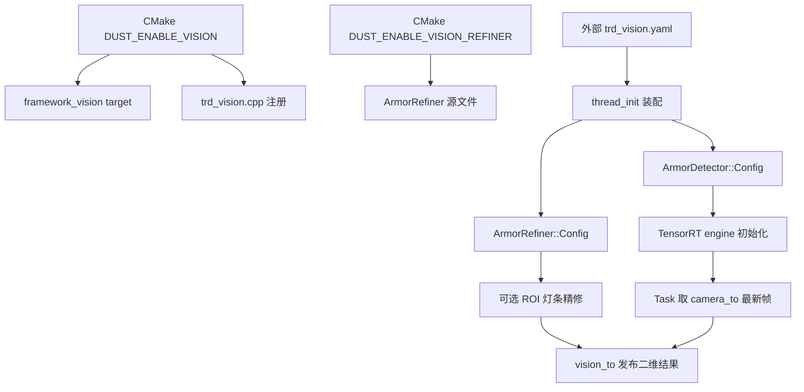

# 视觉配置架构引入规划

日期：2026-10-15。

对象：当前 Linux 视觉工程的构建功能选择、线程运行参数、视觉算法 `Config` 对象和模型部署路径；参考 `temp/Dust_Zephyr_Tree` 的 Kconfig/CMake/模块配置思路。

状态：**规划，尚未实施。** 本文只冻结配置边界和实施顺序，不修改代码、不生成配置目录、不运行程序。

## 1. 结论先行

当前工程不应把 `temp/Dust_Zephyr_Tree` 的 Zephyr Kconfig 原样搬过来。Linux 侧已经有自己的启动注册、CMake 目标和严格 YAML 读取器，直接引入 Kconfig 会形成第二套互相不认识的功能开关。

本次采用“同一思想、不同实现”的三层配置：

```text
构建期功能选择       CMake option / target 依赖
        ↓
线程运行参数         每个线程自己的 YAML，严格字段校验
        ↓
算法对象参数         ArmorDetector::Config / ArmorRefiner::Config，构造时校验
```

三层职责必须分开：

- **构建期**只决定代码和外部依赖是否进入程序，例如是否编译视觉线程、TensorRT 检测器和可选精修器；不放曝光、置信度这类调参值。
- **YAML**只描述一次启动所需的运行参数，例如模型路径、CUDA 设备、门限和精修开关；不负责创建对象、注册线程或保存全局状态。
- **算法 `Config`**是类型化边界，负责单位、范围、参数关系和资源初始化前校验；算法类不读取 YAML，也不依赖线程或 CMake 宏。

这套边界保留参考子树的优点：业务层选择能力，公共层提供能力，模块拥有自己的配置和校验；同时保留当前工程的单槽话题、`REGISTER_INIT`/`REGISTER_THREAD` 和每线程 YAML 语义。

## 2. 两边现状核对

### 2.1 `temp/Dust_Zephyr_Tree` 的实际配置分工

参考子树当前不是一个“运行时配置文件系统”，而是以下几种机制叠加：

| 层 | 参考实现 | 实际作用 | Linux 工程的对应物 |
| --- | --- | --- | --- |
| 业务门禁 | `project/Kconfig` 的 `PRJ_MAIN`、`TRD_*`、`USE_*` | 选择哪些业务线程和功能进入镜像 | 根 CMake / `project/thread/CMakeLists.txt` 的 target 装配 |
| 架构能力 | `framework/*/Kconfig` 的 `DUST_*` | 公共算法、驱动、话题能力按需拉起 | `framework_*` target 的源文件与链接依赖 |
| 平台/板卡 | `project/boards/*/*.conf`、`.overlay`、`board.cmake` | SoC、HAL、引脚和设备树差异 | 当前没有完全对应层；不能把板卡配置混进视觉 YAML |
| 通用系统参数 | `project/prj.conf` | C++、线程、堆栈和 Zephyr 总开关 | CMake 标准、线程库、编译选项 |
| 模块运行对象 | 各类 `Xxx::Config` | 把同一模块的参数集中成类型并由模块校验 | 当前 `ArmorDetector::Config`、`ArmorRefiner::Config` |

参考子树的关键规则是：架构层 `DUST_*` 默认关闭，业务层用 `select DUST_*` 表达依赖；`prj.conf` 不承担具体业务开关；板卡差异不混入业务线程。这个规则可以迁移。

不能直接迁移的部分也要明确：当前 Linux 工程没有 Zephyr 的 Kconfig 生成器、设备树和 `CONFIG_*` 编译环境，不能在代码里凭空写 `CONFIG_TRD_VISION` 就期待 CMake 自动识别；Linux 侧必须由 CMake option/target 负责同等功能。

### 2.2 当前 Linux 工程已经具备的部分

- `framework/cmd/config/config.*` 已提供按调用方声明字段的 YAML 加载、必需字段、未知字段和数值范围校验。
- `project/thread/camera/trd_camera.cpp`、`project/thread/display/trd_display.cpp` 和测试线程各自加载自己的 YAML，参数没有合并到全局配置。
- `framework/algorithm/vision/detect/armor_detector.hpp` 已有 `ArmorDetector::Config`，保存 engine 路径、CUDA 设备和三个推理门限；构造时会校验并在初始化失败时释放 TensorRT/CUDA 资源。
- `framework/algorithm/vision/refine/armor_refiner.hpp` 已有独立的 `ArmorRefiner::Config` 和 `Validate()`，精修参数没有落到线程全局变量。
- `REGISTER_INIT`、`REGISTER_THREAD` 已把资源初始化、线程启动、停止通知、join 和清理分开；配置加载应发生在对应初始化回调中，不能在静态对象构造阶段读 YAML。

### 2.3 当前缺口和已确认的边界问题

1. `project/thread/vision/trd_vision.cpp` 当前把 `ARMOR_ENGINE_PATH` 作为编译定义传给检测线程，视觉 YAML 尚不存在；数字门限和 CUDA device 也没有从线程配置进入 `ArmorDetector::Config`。
2. 根 `CMakeLists.txt` 无条件查找 CUDA/TensorRT、无条件要求 engine，并把默认 engine 指到 `${CMAKE_BINARY_DIR}/0526.engine`。这既不能表达“关闭视觉功能时不需要视觉依赖”，也违反“`build` 只放编译文件”的部署边界。
3. `project/thread/CMakeLists.txt` 用 `configure_file(... COPYONLY)` 把相机、显示和测试 YAML 复制到 `build/project/thread/...`。这属于现有实现事实，后续配置架构计划必须明确移除或改成外部运行配置根，不能继续扩大。
4. 视觉算法目录已经按 `core/`、`detect/`、`refine/` 分层，但配置责任还没有按同样方向落位：算法类知道自己的 `Config`，线程却没有一个明确的“YAML → typed Config”装配边界。
5. 模型资产和编译产物混在构建流程里：参考目录目前只有 `0526.onnx`、OpenVINO 的 `yolov5.xml/.bin` 和 `tiny_resnet.onnx`，没有仓库内固定的 `0526.engine`；engine 应由外部路径提供，不由 CMake 写入 `build`。

## 3. 目标架构

### 3.1 目标依赖方向

```text
project/thread/vision/trd_vision.yaml
        ↓ 由线程读取、转换、打印摘要
VisionRuntimeConfig（线程私有，运行参数）
        ↓ 只在 init 阶段组装
ArmorDetector::Config / ArmorRefiner::Config（算法私有）
        ↓
framework/algorithm/vision（不认识 YAML、线程和 CMake）
```

构建期则是另一条不进入运行时对象的链：

```text
CMake option DUST_ENABLE_VISION
        ↓
framework_vision 源文件与依赖
        ↓
vision_app 是否装配 trd_vision.cpp
```

两条链不互相替代：CMake 关闭视觉时，程序根本不应链接 TensorRT 视觉实现；YAML 中的 `enabled: false` 不能代替构建期裁剪，也不作为第二个全局开关。

### 3.2 只保留单一业务入口

不引入新的 `vision_main`、第二个识别线程、全项目 `config.yaml` 或平行 `framework_config` 目录。现有入口继续是：

- `project/thread/vision/trd_vision.cpp`：配置装配、检测调用、结果发布和统计；
- `framework/algorithm/vision/detect/armor_detector.*`：0526 TensorRT 推理；
- `framework/algorithm/vision/refine/armor_refiner.*`：后续可选的局部灯条精修；
- `framework/topic/vision_to/vision_to.hpp`：结果话题契约。

### 3.3 配置的所有权

| 配置内容 | 所有者 | 是否进 YAML | 是否进 CMake |
| --- | --- | --- | --- |
| 是否编译视觉检测器 | 根工程/`framework` target | 否 | 是 |
| 是否编译视觉线程 | `project/thread/CMakeLists.txt` | 否 | 是 |
| engine 文件路径 | 视觉线程初始化 | 是（或由部署根解析） | 只做可选预检查，不写死成宏 |
| CUDA device | `ArmorDetector::Config` | 是 | 否 |
| score/confidence/NMS 门限 | `ArmorDetector::Config` | 是 | 否 |
| 精修器是否在运行时启用 | 视觉线程 | 是 | 需要精修代码时由 CMake 编译 |
| 灯条精修门限 | `ArmorRefiner::Config` | 是（精修启用时必需） | 否 |
| 相机曝光、增益和采集超时 | 相机线程/`HikRobot::Config` | 仍在相机 YAML | 否 |
| 显示窗口和等待时间 | 显示线程 | 仍在显示 YAML | 否 |
| 结果话题字段和枚举 | `framework/topic` / `core` | 否 | 否 |

## 4. 运行时配置文件设计

### 4.1 文件落点与部署原则

规划新增的源配置文件是：

```text
project/thread/vision/trd_vision.yaml
```

它属于视觉线程，和 `trd_camera.yaml`、`trd_display.yaml` 同级，不并入相机 YAML，也不创建全项目聚合配置。

运行时配置文件不得默认复制到 `build`。后续实现需要先确定一个**构建目录之外**的配置根（例如由启动环境变量或安装/部署脚本提供），并让 `cmd::config::Config::Load()` 支持绝对路径或该配置根下的相对路径。没有配置根时，初始化应报出明确路径错误，而不是偷偷回退到工作目录。

模型 engine 同样不复制进 `build`，不由运行程序生成。它必须来自用户明确提供的稳定路径；模型文件、YAML 和可执行文件是三个不同的部署对象。

### 4.2 第一版视觉 YAML 字段

第一版只放当前 0526 TensorRT 主链确实需要的字段，不预先塞入参考项目的跟踪、PnP、云台和开火参数：

```yaml
engine_path: /absolute/path/to/0526.engine
cuda_device: 0
score_threshold: 0.7
confidence_threshold: 0.8
nms_threshold: 0.3
use_refiner: false
```

仅当 `use_refiner: true` 且构建时启用了精修器时，再在同一文件中提供精修字段：

```yaml
brightness_threshold: 150
min_light_length_px: 8.0
min_light_ratio: 1.5
max_light_ratio: 20.0
max_light_tilt_deg: 45.0
max_endpoint_distance_px: 15.0
```

字段规则：

- `engine_path` 是外部模型资源路径；不得写成 `${CMAKE_BINARY_DIR}/0526.engine`。
- `cuda_device` 必须是非负整数，具体设备是否存在由 detector 初始化阶段验证。
- `score_threshold` 和 `confidence_threshold` 是 `[0,1]` 概率；`nms_threshold` 是 `[0,1]` 的框重叠 IoU 门限；最终置信度不得低于初筛门限。
- `use_refiner` 只是运行期选择。若构建时关闭精修器，YAML 写 `true` 必须在初始化阶段明确报错，而不是静默忽略。
- 精修器字段只有在 `use_refiner: true` 时才允许出现在 YAML；采用“字段集合随功能选择变化”的严格模式，避免无效参数长期漂浮。`use_refiner: false` 时出现任一精修字段也应报错。
- 角度在 YAML 中用 degree 便于人工查看，线程装配时只转换一次为算法使用的 rad；pixel、秒和概率在字段名或注释中写清楚。

第一版不加入 `enemy_color`、`dynamic_roi`、tracker、PnP、planner、shooter 和 TinyMPC。当前 `vision_to` 只发布红蓝两类二维检测，尚未有跟踪器、姿态解算或控制链消费这些参数；提前加入只会制造“配置看起来支持、代码实际上不读”的假能力。

### 4.3 严格读取方式

`trd_vision::thread_init()` 负责：

1. 创建线程私有 `cmd::config::Config` 对象；
2. 加载 `thread/vision/trd_vision.yaml` 的当前部署副本；
3. 声明允许字段集合，拒绝缺失、未知、重复字段；
4. 读取字符串、整数、浮点数和布尔值，检查类型和值域；
5. 转换成 `ArmorDetector::Config`、`ArmorRefiner::Config`；
6. 调用算法对象的 `Validate()` 或构造函数校验；
7. 只在全部成功后创建 TensorRT/CUDA 资源。

配置失败属于初始化失败，不注册线程、不进入相机帧循环、不尝试无限重启。错误日志至少包含配置文件、字段名、期望类型或允许范围。

当前 `cmd::config::Config` 只有 `GetInt()` 和 `GetBool()`；实施时需要补充 `GetDouble()`、`GetString()`，必要时再补一个只做路径规范化的 `GetPath()`。不要把 YAML 节点直接暴露给算法类，也不要在算法类里调用 yaml-cpp。

## 5. 构建期功能选择：用 CMake 映射 Kconfig，不引入第二套配置语言

### 5.1 选项设计

根 `CMakeLists.txt` 增加显式 option，初始默认值保持当前可用行为：

```cmake
option(DUST_ENABLE_VISION "Build TensorRT armor vision" ON)
option(DUST_ENABLE_VISION_REFINER "Build local light-bar refiner" ON)
option(DUST_ENABLE_DISPLAY "Build OpenCV display thread" ON)
```

命名规则对应参考子树但不伪造 `CONFIG_*` 宏：

- `DUST_ENABLE_VISION` 是业务功能门禁，等价于参考的 `TRD_VISION`；
- `DUST_ENABLE_VISION_REFINER` 是视觉能力下的可选算法能力，等价于被业务门禁 `select` 的某个 `DUST_*`；
- `DUST_ENABLE_DISPLAY` 只控制显示线程，不决定视觉算法是否运行。

默认 `ON` 是兼容当前程序的过渡值，不代表所有 profile 都必须打开。关闭某功能时，CMake 应同时裁剪源文件、链接库和对应的初始化注册源；不能只定义一个宏而仍然链接完整实现。

### 5.2 目标与依赖的装配规则

按现有 target 改造，不新增平行入口：

| 文件 | 规划改动 |
| --- | --- |
| 根 `CMakeLists.txt` | 只有 `DUST_ENABLE_VISION=ON` 时查找 CUDA/TensorRT、校验 engine 依赖；移除默认写入 `${CMAKE_BINARY_DIR}/0526.engine` 的路径。 |
| `framework/CMakeLists.txt` | `framework_vision` 只加入被启用的 `detect`/`refine` 源；TensorRT、CUDA、OpenCV dnn 依赖随视觉目标启用。 |
| `project/CMakeLists.txt` | `vision_app` 只在视觉功能启用时接收视觉相关定义和链接；不把模型字节数组编译进可执行文件。 |
| `project/thread/CMakeLists.txt` | 按 option 装配 `trd_vision.cpp`、`trd_display.cpp`；配置文件只进入外部部署目录，不再 `COPYONLY` 到 `build`。 |
| `project/thread/vision/trd_vision.cpp` | 删除 `ARMOR_ENGINE_PATH` 强制宏依赖，改为读取 YAML 并装配 typed `Config`。 |

第一阶段允许保留 `framework_vision` 静态目标名称，避免无关调用点改名；目标内部是否包含精修器由 option 决定。视觉关闭时，`vision_to` 话题类型仍可保留为公共契约，但不应有未使用的视觉线程注册项。

### 5.3 模型资源路径策略

模型是运行资源，不是 C++ 源码，也不是 `build` 产物。规划采用以下约束：

1. CMake 不运行 `trtexec`，不生成 `.engine`，不把模型复制到构建目录。
2. 配置阶段可以检查 `ARMOR_ENGINE_PATH` 是否被显式提供，但不能为它默认为 `${CMAKE_BINARY_DIR}/0526.engine`。
3. 推荐把绝对 engine 路径写入部署侧 `trd_vision.yaml`；如果部署系统不允许绝对路径，再由一个明确的外部配置根解析相对路径。
4. `0526.onnx`、TensorRT `.engine`、OpenVINO `.xml/.bin` 和 `tiny_resnet.onnx` 是不同后端/不同用途的资源，不能只改后缀互换；当前主链固定使用 0526 TensorRT engine。
5. engine 的输入输出契约继续由 `ArmorDetector` 启动时校验，配置层只负责提供路径和基本参数，不把 TensorRT 张量形状复制成第二份可漂移的 YAML 字段。

## 6. 文件级实施计划

### 阶段 0：冻结基线和配置契约（只读）

**目标：** 先把当前行为、路径和字段写成可检查的基线，不改代码。

- 记录当前 `trd_vision.cpp` 的编译定义、检测器默认门限、TensorRT 10.x 依赖和 `vision_to` 发布结构。
- 记录 `cmd::config::Config` 当前支持的类型、路径解析规则和 `configure_file` 生成位置。
- 记录参考 `project/Kconfig` 的业务门禁、`framework/*/Kconfig` 的能力门禁及典型模块 `Config` 的校验方式。
- 将旧文档中“默认生成 `build/0526.engine`”标记为待修订事实；在新架构生效前不宣称已经完成路径迁移。

**验收：** 只读 `rg` 能分别找到每个配置字段的唯一读取点；没有一个新字段只出现在 YAML 注释中而没有消费者。

### 阶段 1：扩展通用 YAML 读取器

**落点：** `framework/cmd/config/config.hpp/.cpp`。

- 增加 `GetDouble()` 和 `GetString()`，统一检查空键、未加载、标量类型和有限性；数值范围由调用方传入。
- 如需 `GetPath()`，只做绝对路径保留、相对路径按显式配置根解析和存在性检查，不把模型路径偷偷改写到 `build`。
- 保留当前“调用方声明字段集合”的接口，不增加全局 schema 注册表，不允许不同线程共享一个可变 `Config` 对象。
- 错误文本增加配置文件相对/绝对路径，方便多个线程的启动失败定位。

**验收：** 用已有 camera/display/test YAML 做缺字段、未知字段、错误类型、越界和合法值测试；行为不能回退到工作目录猜路径。

### 阶段 2：视觉线程 YAML 与 typed Config 装配

**落点：** `project/thread/vision/trd_vision.yaml`、`project/thread/vision/trd_vision.cpp`、必要时 `ArmorDetector::Config` 的校验函数。

- 新增视觉线程自己的 YAML，字段严格按 §4.2 冻结。
- 在 `thread_init()` 内建立线程私有运行参数结构（可先放在 `trd_vision.cpp` 的匿名命名空间，不急着新增公共头文件）。
- 把 YAML 值转换到 `ArmorDetector::Config` 和可选 `ArmorRefiner::Config`；算法对象只接收已经类型化的配置。
- 先校验配置和模型路径，再创建 detector/refiner；任何一步失败都由现有 `HaltOnFail` + `Release()` 路径清理。
- 初始化日志只输出解析后的关键摘要（engine 路径、device、门限、refiner 开关），不在逐帧日志重复打印。

**验收：** 只改 YAML 的门限或 device，重新启动即可看到摘要改变且无需重新编译；缺失/未知字段在 CUDA/TensorRT 初始化前失败；`Task()` 中不再出现配置读取。

### 阶段 3：CMake 功能门禁和外部配置部署

**落点：** 根 `CMakeLists.txt`、`framework/CMakeLists.txt`、`project/CMakeLists.txt`、`project/thread/CMakeLists.txt`。

- 引入 §5.1 的 CMake options，默认值保持兼容。
- 视觉关闭时不查找 TensorRT、不要求 engine、不编译 `trd_vision.cpp`；显示关闭时不编译显示线程。
- 删除或替换把 YAML 和模型复制到 `build` 的规则；构建目录只保留 CMake/编译/链接中间产物和最终可执行文件。
- 明确外部配置根的来源（部署脚本、环境变量或启动参数三选一，实施前冻结一种），并让 camera/display/test/vision 一致使用，不为视觉另造特殊查找逻辑。
- 不在此阶段改变线程注册阶段、话题槽语义、相机重连和 180° 回正逻辑。

**验收：**

- `DUST_ENABLE_VISION=OFF` 的配置阶段不访问 TensorRT/CUDA 和 engine；
- `DUST_ENABLE_VISION=ON` 仍按外部路径加载同一个 0526 engine；
- `find build -type f` 中没有由构建系统复制进去的运行 YAML 或模型资源；
- 各 option 组合下不存在未定义注册符号、重复线程入口或链接期缺失源文件。

### 阶段 4：可选精修能力接入

这一步不是配置系统的前置条件，只在当前主链稳定后做：

- `DUST_ENABLE_VISION_REFINER=ON` 时编译 `ArmorRefiner`；
- `trd_vision.yaml` 的 `use_refiner` 决定本次运行是否调用精修器；
- build-time `OFF` + runtime `true` 必须给出明确错误；build-time `ON` + runtime `false` 不应创建或执行精修器；
- 精修统计进入现有 `vision` 一秒汇总，不新建第二个结果话题。

这一步仍只做“YOLO 粗四点 → ROI 灯条提取 → 可接受时替换四点”，不借此引入参考项目的传统全图 detector、数字分类器、tracker 或 PnP。

### 阶段 5：文档与部署收口

- 更新 `README.md` 的依赖、engine 路径和配置启动说明，删掉“默认 build/0526.engine”的旧事实。
- 更新 `doc/framework视觉识别流程说明.md`，增加“YAML → typed Config → detector”段落，并把精修配置标为可选。
- 旧的 `doc/装甲板识别规划.md` 中关于“暂不新增 `trd_vision.yaml`”的临时决策，在本计划实施后必须改成新的配置契约，不能两份文档同时作为规范。
- 写明实际部署清单：可执行文件、外部 YAML、外部 engine、CUDA/TensorRT/MVS 运行库；不把任何一项伪装成源码或 build 中间文件。

## 7. 配置与功能的依赖图



图中 A/D 是“有没有这段代码”，F 是“这次运行用什么参数”。任何运行时 YAML 字段都不能越过线程直接改 CMake feature；任何 CMake option 也不能靠运行时 YAML 把没编译的代码变出来。

## 8. 验收标准

### 8.1 配置读取

| 验收项 | 目标 |
| --- | --- |
| 缺少必需字段 | 初始化前失败，指出文件和字段 |
| 未知字段 | 初始化前失败，不静默忽略拼写错误 |
| 错误类型 | 初始化前失败，指出期望类型 |
| 数值越界/关系不一致 | 进入算法对象前失败，例如 confidence 小于 score |
| 模型路径不存在 | 不创建线程，不进入帧循环，清理已经创建的资源 |
| 配置修改 | 只改 YAML 后重启即可生效；不需要重新编译 |
| 多线程隔离 | camera/display/vision 各自声明字段，互相不能读取对方 YAML |

### 8.2 构建功能选择

至少验证以下 profile：

```text
DUST_ENABLE_VISION=ON,  DUST_ENABLE_VISION_REFINER=OFF
DUST_ENABLE_VISION=ON,  DUST_ENABLE_VISION_REFINER=ON
DUST_ENABLE_VISION=OFF, DUST_ENABLE_DISPLAY=ON
```

每个 profile 都要检查：

- CMake 配置阶段访问的外部依赖与 option 一致；
- 源文件只被加入一次；
- 注册段中只有实际编译的线程入口；
- 关闭视觉不会遗留 TensorRT、CUDA 或 engine 的链接/运行时要求；
- 默认 ON profile 的检测输出、`camera_to` 取帧、180° 回正、`vision_to` 发布和显示行为与当前基线一致。

### 8.3 运行时观测

视觉初始化日志至少包含：

```text
feature=vision
engine=<resolved external path>
cuda_device=<n>
score/confidence/nms=<...>
refiner=compiled|disabled, enabled|disabled
config_root=<resolved path>
```

运行期仍沿用现有每秒一条汇总：输入取帧/丢帧、推理分段耗时、有效候选和精修状态。配置系统不得逐帧打印 YAML，也不得为了“证明参数生效”增加新的无界日志。

### 8.4 build 目录边界

验收必须单独检查这一条：

- `build/` 只保留编译数据库、CMake 中间文件、目标文件、库和可执行文件等构建产物；
- 不出现 `trd_*.yaml`、`.onnx`、`.engine`、`.xml/.bin` 的复制品；
- 删除 `build` 后，外部配置和模型仍可由部署根找到；
- 配置文件和模型删除/移动时，程序给出可解释错误，不自动重新生成或下载。

## 9. 风险与处理

| 风险 | 表现 | 处理 |
| --- | --- | --- |
| CMake option 与注册宏脱节 | 关闭视觉后仍有 `vision_init` 或链接错误 | 源文件装配和注册入口同一条件控制；每个 profile 做干净配置 |
| YAML 仍复制到 build | 删除 build 后运行依赖消失 | 先冻结外部配置根，再删除 `configure_file(... COPYONLY)`，不保留双路径回退 |
| 模型路径重复存在于 CMake 与 YAML | 改了一处但实际使用另一处 | 选一个运行时真源；推荐 YAML/部署根，CMake 只做依赖开关 |
| 把参考配置全搬进来 | 出现 tracker/PnP/planner 字段但当前没有消费者 | 每个字段必须先找到唯一读取点；未实现能力留在参考项目，不进入本版 YAML |
| 直接在算法类里读 YAML | 算法库依赖 yaml-cpp，测试和复用变差 | 线程完成 YAML → typed Config，算法只接收结构体 |
| 关闭精修后 YAML 仍保留精修字段 | 配置看似合法但功能不存在 | 采用 build/runtime 双层校验，或暂时允许字段但必须显式 warning；第一版推荐严格失败 |
| 相对路径依赖当前工作目录 | IDE、脚本、systemd 启动结果不同 | 只允许绝对路径或显式配置根解析；禁止隐式 cwd 搜索 |
| 为了“像 Kconfig”引入真实 Kconfig | CMake、Kconfig、YAML 三套开关冲突 | Linux 侧只实现 CMake 映射，文档中明确不生成 `CONFIG_*` |

## 10. 明确不做

1. 不把 `temp/Dust_Zephyr_Tree` 复制进当前工程，也不把 Zephyr、设备树或 Kconfig 生成器作为 Linux 构建依赖。
2. 不新增全局 `config.yaml`、全局单例配置、配置总线或跨线程可变参数对象。
3. 不把 camera/display/test 的现有参数迁移到视觉 YAML；每个线程继续拥有自己的配置。
4. 不在本计划内接入参考项目的 OpenVINO、TensorRT 双后端切换；当前检测器固定 0526 TensorRT，后端扩展另立规划。
5. 不在本计划内引入 `tiny_resnet.onnx` 数字分类、传统全图灯条检测、动态 ROI、tracker、PnP、planner、shooter 或 TinyMPC 配置。
6. 不把 engine 转成 C/C++ 数组，不把模型编译进 `vision_app`；模型继续作为外部部署资源由 TensorRT 加载。
7. 不修改相机 180° 回正、最新帧单槽话题、线程停止顺序和 `vision_to` 的消息语义。
8. 不因为配置系统改造而顺手重排 `framework/algorithm/vision` 的目录或格式化现有代码。

## 11. 实施顺序与完成定义

建议提交粒度如下，每一步都可独立回退：

1. **配置 API**：补 `GetDouble()`、`GetString()`，用现有三个线程 YAML 做负例测试。
2. **视觉装配**：新增 `trd_vision.yaml`，让 `thread_init()` 完成 YAML → typed Config → detector 初始化。
3. **模型路径收口**：把 engine 改为外部路径，移除 build 默认 engine 和视觉编译宏的唯一真源冲突。
4. **CMake 门禁**：增加 vision/refiner/display feature option，按 profile 裁剪源、依赖和注册入口。
5. **配置部署**：冻结外部配置根，删除 YAML 到 build 的复制规则，补齐运行说明。
6. **可选精修**：只在主链行为基线保持一致后接入 `ArmorRefiner::Config` 和 `use_refiner`。
7. **文档收口**：同步 README、视觉流程说明和旧装甲板规划中的临时配置决策。

本规划完成的判据不是“能读一个 YAML”，而是以下条件全部成立：

- 构建期 feature 选择和运行期参数各有唯一真源；
- 算法库不依赖 YAML，线程不硬编码模型/阈值；
- 缺失、未知、错误和越界配置都在资源初始化前失败；
- 视觉关闭时不要求 TensorRT/CUDA/engine；
- engine、YAML 和可执行文件均位于明确的部署位置，`build` 无运行资源副本；
- 当前 0526 检测链、相机话题和线程生命周期无行为回归；
- 每个新增字段都有源码读取点、单位、范围、默认策略和验收命令；
- 文档中的“已完成”均由构建日志、配置负例或运行日志支撑，不以 CMake 配置成功代替运行验证。

## 12. 参考源码与当前工程对照

参考子树：

- [project/Kconfig](../temp/Dust_Zephyr_Tree/project/Kconfig)：业务门禁和 `select DUST_*` 依赖；
- [project/CMakeLists.txt](../temp/Dust_Zephyr_Tree/project/CMakeLists.txt)：Kconfig 结果如何进入 CMake 装配；
- [framework/algorithm/Kconfig](../temp/Dust_Zephyr_Tree/framework/algorithm/Kconfig)：公共算法能力默认关闭；
- [子树架构介绍.md](../temp/Dust_Zephyr_Tree/子树架构介绍.md)：`Kconfig → CMake → DTS/BOARD_ROOT` 和配置规则；
- [power_ctrl.hpp](../temp/Dust_Zephyr_Tree/framework/algorithm/controller/power_ctrl/power_ctrl.hpp)：模块拥有 typed `Config`、校验和状态；
- [pid.hpp](../temp/Dust_Zephyr_Tree/framework/algorithm/controller/pid/pid.hpp)：小型算法对象的配置边界。

当前工程：

- [config.hpp](../framework/cmd/config/config.hpp)：线程侧 YAML 读取接口；
- [config.cpp](../framework/cmd/config/config.cpp)：路径和字段校验实现；
- [trd_camera.cpp](../project/thread/camera/trd_camera.cpp)：每线程 YAML 装配示例；
- [armor_detector.hpp](../framework/algorithm/vision/detect/armor_detector.hpp)：当前视觉 typed `Config` 与资源校验边界；
- [trd_vision.cpp](../project/thread/vision/trd_vision.cpp)：当前视觉线程仍使用编译期 engine 宏、待迁移的装配入口；
- [根 CMakeLists.txt](../CMakeLists.txt)：当前 TensorRT 查找和 build engine 默认路径，实施时需要按本规划修订。
