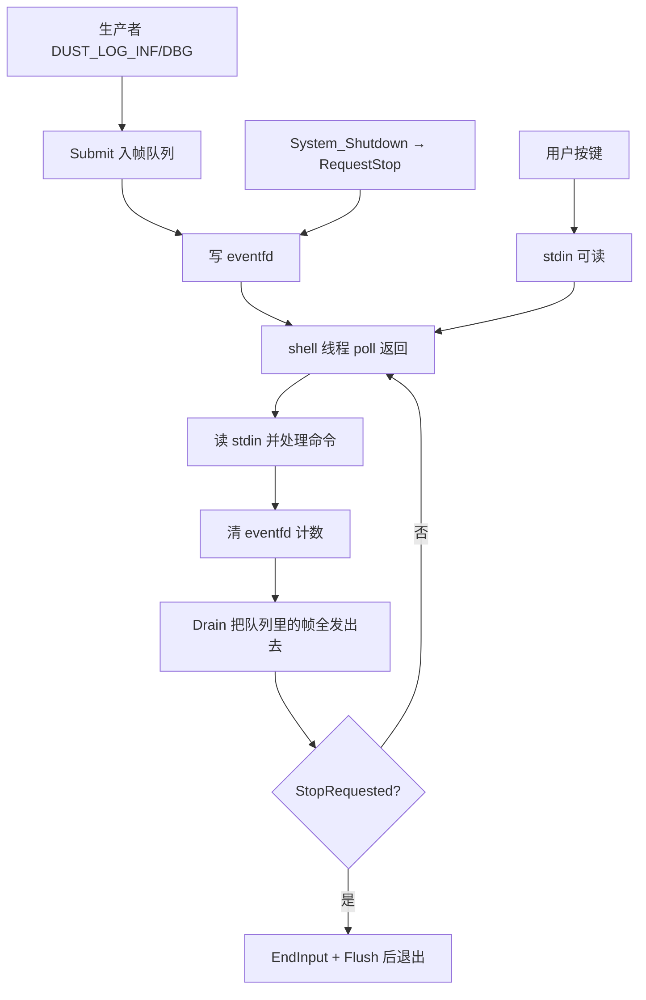

# 调试台线程 CPU 空转问题与修改方案

日期：2026-10-12。

对象：`framework/cmd/shell/shell.cpp` 里 `Task()` 的等待方式，以及它依赖的日志发送泵。

状态：**方案，代码尚未改动。** 实施前先按第 1 节量一遍，第 1 节也写了"如果量出来的和本文判断不一致"该怎么走。

## 1. 现象与先要量到的三个数

现象：没有输入、也没有日志输出的时候，shell 线程仍在持续占用 CPU，在 `top -H` / `pidstat -t` 里能看到它。

本文的判断是：占用来自**固定频率的空转唤醒**，不是它干了多少活。所以先量唤醒次数，再量 CPU 时间。程序用 `dust run` 起，线程名是 `shell`（[thread.hpp:131](../framework/init/thread.hpp#L131) 里 `pthread_setname_np`）。

```bash
pid=$(pgrep -x vision_app)
tid=$(grep -l '^shell$' /proc/$pid/task/*/comm | cut -d/ -f5)

# ① 每秒采样一次，看 shell 这一行的 %CPU 和 %SYSTEM
pidstat -t -p "$pid" 1 10

# ② 空闲 60 s 的自愿上下文切换增量（本文预测 ≈6000，见 §2.2）
grep ctxt /proc/$pid/task/$tid/status

# ③ CPU 时间增量，单位 tick（14=utime, 15=stime）
awk '{print $14+$15}' /proc/$pid/task/$tid/stat
```

| 指标 | 修复前（待实测填入） | 修复后目标 | 说明 |
| --- | --- | --- | --- |
| 空闲 60 s 自愿切换 `voluntary_ctxt_switches` | 待填，预测 ≈6000 | < 10 | 主判据 |
| `pidstat -t` 里 shell TID 的 `%CPU` | 待填 | < 0.01% | 次要，绝对值本来就小 |
| `utime+stime` 60 s 增量 | 待填 | 接近 0 | tick 数 ÷ `getconf CLK_TCK` |

**这三个数必须实测填进去，本文不预填。** 如果 ① 里 shell 的 `%CPU` 明显超过 1%，那不是本文说的空转，先看 §6.4 的分支。

## 2. 根因

### 2.1 代码事实：循环频率与事件无关

[shell.cpp:188-231](../framework/cmd/shell/shell.cpp#L188-L231) 的循环只有三个动作：

```cpp
for (;;)
{
    Log::SendNextFrameIfIdle();                              // ① 尝试发队列里的帧

    if (input_open)
    {
        pollfd descriptor{STDIN_FILENO, POLLIN, 0};
        const int ready = ::poll(&descriptor, 1, 0);         // ② 超时 0 = 看一眼就走，不等待

        ...
    }

    if (thread_.WaitForStop(std::chrono::milliseconds(10)))  // ③ 每轮固定等 10 ms
    {
        break;
    }
}
```

③ 是循环唯一的节拍来源，而且它**无条件执行**：队列空、没有按键、没有停止请求时，线程照样每 10 ms 醒一次，把 ①② 再跑一遍。

### 2.2 唤醒量是可以算出来的

- 周期 = 10 ms → 唤醒 **100 次/s**。
- 每轮至少 2 次系统调用：`poll`（②）和 `futex` 定时等待（③ 在没有通知时会超时返回）。
- 空闲 60 s 的自愿切换 = 100 × 60 = **6000 次**；一天 = 100 × 86400 = **8.64×10⁶ 次**唤醒，对应 ≥1.7×10⁷ 次系统调用。
- 反过来说，每次唤醒实际处理的工作是 0 帧、0 字节。**100% 的唤醒是空转。**

按 syscall 量级（各约 1~3 µs）估算，这个空转本身只值 **0.03%~0.1% 单核**——它的问题不是"占了多大比例"，而是**每 10 ms 就在调度器里插一次**。这在当前工程里有两个具体代价：

1. 视觉主循环按 1 kHz 走时，shell 每 10 ms 抢一次 CPU 和 `log mutex_`，等于给控制线程加了 10% 的额外调度次数。
2. 主线程 [Init_entry.cpp:244-250](../framework/init/Init_entry.cpp#L244-L250) 的 `System_WaitForStop()` 是同一个写法（10 ms 轮询 `stop` 标志），两处叠起来是 200 次/s。

### 2.3 与参考实现的差异

`temp/Dust_Zephyr_Tree/framework/cmd/shell/shell.cpp`（Zephyr 版）的 `Shell::Task()` 是：

```cpp
k_sem_take(&stream_->sem_, K_FOREVER);         // 无事件则永久阻塞
Log::SendNextFrameIfIdle();                    // 被唤醒后驱动发送泵
```

由 UART 接收事件和发送完成事件唤醒，**空闲时 0 次唤醒**。Linux 移植时，事件源换成 stdin，但等待方式退化成了"轮询 + 固定睡眠"。

| | Zephyr 版（参考） | 当前 Linux 版 |
| --- | --- | --- |
| 等待 | `k_sem_take(K_FOREVER)`，事件驱动 | `poll(超时 0)` + 每轮 `WaitForStop(10 ms)` |
| 空闲唤醒 | 0 次/s | 100 次/s |
| 日志发送驱动 | 发送完成回调触发继续发 | shell 线程固定节拍轮询队列 |

### 2.4 这是"没写对"还是"故意的"

[shell.cpp:181](../framework/cmd/shell/shell.cpp#L181) 的注释写着"stdin EOF 后继续驱动日志，不忙循环"——意图明确是不要忙等。10 ms 是为了让日志输出不被无限阻塞：队列里进了帧，只有 shell 线程在发，而它正阻塞在 `poll(stdin)` 上就发不出去。所以问题的本质不是"睡眠太短"，而是**日志这一侧没有唤醒 shell 线程的手段，只能用时间兜底**。

## 3. 修改方案：把 shell 线程改成事件驱动

思路：给 shell 线程一个**可等待的事件源**，让它 `poll` 到"有输入 / 有帧要发 / 被要求停止"三者之一才醒，其余时间真正阻塞。



`eventfd` 的计数是**粘性**的：不读就一直可读，所以不存在"唤醒早于等待"导致的丢唤醒。清计数必须放在 `Drain()` **之前**（§3.3 第 ③④ 步）：先清计数再发送，发送期间新入队的帧会重新置位，下一次 `poll` 立即返回；反过来先发后清，会把这个置位一起清掉，留下队里有人但没人唤醒的局面。

### 3.1 落点一：`Log` 持有一个进程级 eventfd

文件：[framework/cmd/shell/log.hpp](../framework/cmd/shell/log.hpp)、[framework/cmd/shell/log.cpp](../framework/cmd/shell/log.cpp)

```cpp
// log.hpp 新增（public）
static int  WakeFd();          // 发送泵的等待描述符；Init 创建，进程生命周期内有效
static void ConsumeWake();     // 清计数；调用方须在 Drain 之前调用

// log.cpp 新增
static int wake_fd_ = -1;      // 匿名命名空间

bool Log::Init()
{
    std::lock_guard<std::mutex> lock(mutex_);
    dbg_.Reset();
    txq_.Reset();
    pump_.Reset();
    shell_own_ = false;
    wake_fd_ = ::eventfd(0, EFD_NONBLOCK | EFD_CLOEXEC);   // 失败即返回 false
    return wake_fd_ >= 0;
}

int Log::WakeFd() { return wake_fd_; }
```

把创建放在 `Log::Init()` 里的好处是**失败路径是现成的**：`Log::Init()` 由 `REGISTER_INIT(thread_init, PreInit, High, HaltOnFail, ...)` 调用（[shell.cpp:242-245](../framework/cmd/shell/shell.cpp#L242-L245)、[shell.cpp:285](../framework/cmd/shell/shell.cpp#L285)），返回 false 会走 [Init_entry.cpp:129-133](../framework/init/Init_entry.cpp#L129-L133) 的 `HaltOnFail` 中止启动。**不许**在创建失败时退化成轮询。

### 3.2 落点二：入队后唤醒

文件：[framework/cmd/shell/log.cpp](../framework/cmd/shell/log.cpp) 的 `Submit()`（[log.cpp:190-207](../framework/cmd/shell/log.cpp#L190-L207)）

```cpp
void Log::Submit(const LogRecord& record)
{
    const auto frame = FormatRecordToFrame(record);
    if (!txq_.Push(frame))
    {
        if (frame.priority == TxPriority::Dbg)
        {
            return;                       // DBG 被挤出：没有新帧，不需要唤醒
        }
        Drain();                          // 事件不能被同类满池丢弃：先排空再登记
        txq_.Push(frame);
    }
    if (!shell_own_)
    {
        Drain();                          // 启动/关闭期：调用点直发，行为不变
        return;
    }
    const uint64_t one = 1;
    const auto written = ::write(wake_fd_, &one, sizeof(one));
    (void)written;                        // EAGAIN = 计数已饱和，说明本来就要醒
}
```

要点：

- **只在 `shell_own_` 为真时唤醒**。启动早期调用点直发，队列留在那里的帧由生产者自己发完，不会出现"没人发"。
- **`write` 的返回值不检查**。`eventfd` 非阻塞写在计数饱和时返回 `EAGAIN`，这时泵必然处于"已可读"状态，忽略即可；这里也**不能**报错退出——它工作在日志锁内。
- 被挤出的 DBG 帧不唤醒，因为队里没有新增内容。

### 3.3 落点三：shell 线程的等待循环

文件：[framework/cmd/shell/shell.cpp](../framework/cmd/shell/shell.cpp) 的 `Task()`（[shell.cpp:183-235](../framework/cmd/shell/shell.cpp#L183-L235)）

```cpp
static void Task(void*, void*, void*)
{
    Log::MarkShellThreadReady();
    bool input_open = true;

    for (;;)
    {
        pollfd descriptors[2] = {{STDIN_FILENO, POLLIN, 0}, {Log::WakeFd(), POLLIN, 0}};
        const nfds_t count = input_open ? 2 : 1;
        if (!input_open)
        {
            descriptors[0] = descriptors[1];      // stdin 已关闭：只等唤醒描述符
        }

        const int ready = ::poll(descriptors, count, -1);   // ① 真正阻塞，无超时
        if (ready < 0)
        {
            if (errno == EINTR)
            {
                continue;
            }
            break;
        }

        // ② 输入优先：命令的响应再入队，顺序与现在一致
        if (input_open && (descriptors[0].revents & (POLLIN | POLLHUP)))
        {
            char buffer[256];
            const auto size = ::read(STDIN_FILENO, buffer, sizeof(buffer));
            if (size == 0)
            {
                input_open = false;
                Log::EndInput();
            }
            else if (size < 0 && errno != EINTR && errno != EAGAIN)
            {
                input_open = false;
            }
            if (size > 0)
            {
                shell_.ProcessInput(buffer, static_cast<size_t>(size));
            }
            if (descriptors[0].revents & (POLLERR | POLLNVAL))
            {
                input_open = false;
            }
        }

        // ③ 先清计数再发送：发送期间新入队的帧会重新置位，poll 立刻返回
        Log::ConsumeWake();

        // ④ 发送：把队列里所有帧发完
        Log::SendNextFrameIfIdle();

        if (thread_.StopRequested())
        {
            break;
        }
    }

    Log::EndInput();
    Log::Flush();
}
```

`input_open` 变成 false 后数组只留一个元素，**注意 `descriptors[0]` 此时指的是唤醒描述符**，所以还要用原来的 `input_open` 判断来决定读不读 stdin——上面对 stdin 的处理整段包在 `if (input_open && ...)` 里，就是为了避开这个下标陷阱。

### 3.4 落点四：`Thread` 支持"停止时唤醒"

文件：[framework/init/thread.hpp](../framework/init/thread.hpp)

```cpp
// 新增：在 Start() 之前调用；仅用于以 poll 等待的业务线程
void SetWakeFd(int fd)
{
    wake_fd_ = fd;
}

// 新增：无锁读取停止标志，供 poll 返回后判断
bool StopRequested() const
{
    return stop_.load();
}

// RequestStop() 末尾追加：唤醒正阻塞在 poll 上的线程
void RequestStop()
{
    {
        std::lock_guard<std::mutex> lock(mutex_);
        stop_ = true;
    }
    condition_.notify_all();
    if (wake_fd_ >= 0)
    {
        const uint64_t one = 1;
        const auto written = ::write(wake_fd_, &one, sizeof(one));
        (void)written;
    }
}
```

同时把 `bool stop_ = false;` 改成 `std::atomic<bool> stop_{false};`（现有的 `WaitForStop` 在锁内读它，语义不变）。`wake_fd_` 默认 -1，**test 线程不设置它，行为完全不变**。

调用处在 [shell.cpp:252-256](../framework/cmd/shell/shell.cpp#L252-L256) 的 `thread_start()`：

```cpp
static bool thread_start()
{
    if (Log::WakeFd() < 0)
    {
        return false;                     // Init 未成功，宁可不启动也不退化轮询
    }
    thread_.SetWakeFd(Log::WakeFd());
    thread_.Start(Task, nullptr, "shell");
    return true;
}
```

## 4. 不采用哪些替代做法

| 做法 | 为什么不行 |
| --- | --- |
| 把 10 ms 改成 1 ms / 100 ms | 还是轮询，只是换频率。1 ms 变成 1000 次/s 唤醒，更糟 |
| 去掉发送泵，让业务线程直接写终端 | 回到输入显示和日志抢屏（[SIGPIPE 文档 §8](SIGPIPE问题说明与解决方案.md) 之前的状态），还把终端 I/O 的阻塞摊到控制线程上 |
| 用 SIGUSR1 唤醒 shell | 异步信号回调里不能安全地加锁、发日志；与 [SIGPIPE 文档 §5](SIGPIPE问题说明与解决方案.md) 拒绝的做法同类 |
| 给 shell 线程降 nice / 设 `SCHED_IDLE` | 不减少唤醒次数，只是竞争时让路；100 Hz 照样插进控制循环 |
| 把帧池 `kTxPoolSize` 调大 | 不解决唤醒，那是另一类问题（突发日志的缓冲深度） |

## 5. 验收方法

### 5.1 空闲不再空转（主判据）

```bash
pid=$(pgrep -x vision_app)
tid=$(grep -l '^shell$' /proc/$pid/task/*/comm | cut -d/ -f5)
grep ctxt /proc/$pid/task/$tid/status     # 记一次
sleep 60
grep ctxt /proc/$pid/task/$tid/status     # 再记一次，diff 应 < 10
```

修复前 diff ≈6000（10 ms × 60 s）。若 `pidstat -t -p "$pid" 1` 里 `%CPU` 掉到 0.0 且切换数达标，这条通过。

### 5.2 功能不回归

| 场景 | 预期 | 证据 |
| --- | --- | --- |
| `log on test`（心跳 1000 ms） | 仍按 1 Hz 输出，不再有"最长多等 10 ms"的额外延迟 | 时间戳相邻间隔 ≈1 s |
| `log off` | 立即停 | 之后无 DBG 行 |
| 逐字输入、退格、左右、Home/End、Delete、Ctrl+U | 与修复前一致 | 终端回显正常 |
| 长命令超 255 字节 | 整行丢弃并提示 | `command too long` |
| stdin 关闭（EOF / `< /dev/null`） | 线程继续驱动日志，不退出、不空转 | 主判据仍达标 |
| Ctrl+D（空行时）、Ctrl+C、SIGTERM | 正常关闭，终端属性恢复 | 退出码与 SIGPIPE 文档一致 |
| 启动前 stderr 断管 | 仍退出 1 | [SIGPIPE 文档 §6.1](SIGPIPE问题说明与解决方案.md) 用例 |

### 5.3 停止延迟

`System_Shutdown()` 先 `request_stop` 再 `join`（[Init_entry.cpp:255-276](../framework/init/Init_entry.cpp#L255-L276)）。修复后唤醒是即时的，从 Ctrl+C 到 shell 线程退出的时间应 **≤ 50 ms**（原来要等一次 10 ms 轮询 + 一次 join）。测法：

```bash
time (kill -INT $pid; while kill -0 $pid 2>/dev/null; do :; done)
```

### 5.4 现有测试全过

`broken_pipe_cleanup`、`terminal_input` 和原有 3 项测试（[SIGPIPE 文档 §9](SIGPIPE问题说明与解决方案.md)）在 Debug 与 Release 下都保持通过；`terminal_input` 里用 20 ms 心跳，正好覆盖"高频 DBG + 输入混排"这条路径。

## 6. 失败分叉

| 症状 | 先查什么 | 最后才查 |
| --- | --- | --- |
| 启动直接中止，日志停在 `shell_init` | `eventfd` 创建失败？`Log::Init()` 返回值 | 进程 fd 上限（`ulimit -n`） |
| 修复后唤醒数没降 | `ConsumeWake` 是否在 `Drain` **之前**调用 | 是不是还有别的地方在 10 ms 醒（§6.4） |
| 日志卡住不输出，`log on` 后无反应 | `Submit` 里唤醒是否只在 `shell_own_` 后执行；`WakeFd()` 是否已创建 | 帧被挤出（DBG 满池丢弃） |
| Ctrl+C 后进程挂住不退出 | `RequestStop` 是否写到了 `wake_fd_`；`SetWakeFd` 是否在 `Start` 之前 | `poll` 是不是还带超时 |
| `stdin` 关闭后反而变忙 | `input_open` 为 false 时数组压缩、`descriptors[0]` 指向是否正确 | — |
| 键盘输入没回显 | §3.3 里 stdin 处理整段是否都在 `if (input_open && ...)` 内 | 终端是不是被重定向（`BeginInput` 会跳过） |

### 6.4 如果实测 %CPU 明显偏高（>1%），根因就不是空转

这时 shell 线程的时间花在**同步写终端**上：[log_transport.cpp:45-58](../framework/cmd/shell/log_transport.cpp#L45-L58) 每帧一次 `fwrite` + `fflush`，1000 帧/s 就是 2000 次系统调用/s。判据：

```bash
pidstat -t -p "$pid" 1        # 看 shell 行的 %SYSTEM 是否远大于 %usr
```

若是这条，修改点是"收发解耦"——发送侧攒批 + 合并 `fflush`，或给帧队列加背压——那是另一个方案，不属于本文。**先量，再决定改哪个**；本文 §3 只是把空转那部分删掉。

## 7. 修改范围与边界

**要动的：**

| 文件 | 改动 |
| --- | --- |
| [framework/cmd/shell/log.hpp](../framework/cmd/shell/log.hpp)、[log.cpp](../framework/cmd/shell/log.cpp) | 新增 `WakeFd()`、`ConsumeWake()`；`Init()` 创建 `eventfd`；`Submit()` 入队后唤醒 |
| [framework/init/thread.hpp](../framework/init/thread.hpp) | 新增 `SetWakeFd()`、`StopRequested()`；`RequestStop()` 追加唤醒；`stop_` 改 `std::atomic` |
| [framework/cmd/shell/shell.cpp](../framework/cmd/shell/shell.cpp) | `Task()` 改成阻塞 `poll`；`thread_start()` 绑定唤醒描述符 |

**不动的：** 帧池大小与优先级策略（[log_policy.hpp](../framework/cmd/shell/log_policy.hpp)）、`FormatRecordToFrame` 的帧格式、终端重绘协议、`REGISTER_INIT`/`REGISTER_THREAD` 宏与阶段顺序、`temp/Dust_Zephyr_Tree` 下的参考实现。

**仍存在的边界（本文不解决）：**

1. 主线程 [Init_entry.cpp:244-250](../framework/init/Init_entry.cpp#L244-L250) 的 `System_WaitForStop()` 还是 10 ms 轮询，是同一个毛病的另一处。要用同一套办法得给它单独的 `eventfd`（和 shell 共用会互相把对方的事件吃掉）。**要不要一起改，你定。**
2. 终端写不进去时（管道读端不读）`fwrite` 的阻塞没有时间上界——[SIGPIPE 文档 §7](SIGPIPE问题说明与解决方案.md) 已经点过，属于另一件事。
3. 本文只处理"空闲空转"。高频 DBG 下的丢帧、DBG 与终端刷新率的匹配，都不在这里改。
